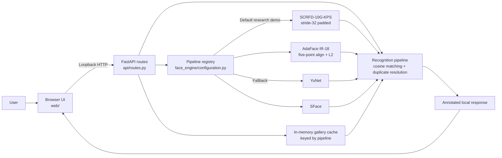

# FaceFind architecture

## Startup and pipeline selection

The app defaults to `scrfd_adaface` for the local assignment demo. Set
`FACEFIND_DEFAULT_PIPELINE=yunet_sface` to start with the tracked fallback.
Model bundles initialize once per process; the fallback initializes lazily
when selected if it has not yet been loaded. The UI can switch between the two
configurations through the local `/api/pipeline` endpoint.

SCRFD uses the evaluated KPS adapter, including aspect-preserving downscaling
to 1,280 pixels, bottom/right stride-32 padding, and mapping detections back to
the original image. AdaFace uses five-point similarity alignment to 112×112,
BGR normalization, a 512-dimensional L2-normalized embedding, and cosine
matching. Its 50-gallery calibration threshold is 0.26362 with a 0.07940
top-score margin. These values are specific to the research configuration.
YuNet + SFace retains the original matcher and thresholds.

## Gallery lifecycle and request flow

1. The gallery upload endpoint decodes each reference, detects faces, embeds
   single-face references once, and stores the resulting normalized vectors in
   memory. Multi-face references enter a numbered manual-selection queue.
2. The gallery cache is held separately for each pipeline. A failed or empty
   replacement does not evict a working gallery, and embeddings with different
   dimensions or pipeline IDs cannot be mixed.
3. The analyze endpoint detects group-photo faces, aligns and embeds each face,
   applies the selected matcher, resolves duplicate identity assignments, and
   returns an annotated JPEG plus per-face results and timing fields.
4. Repeated analyses reuse the active pipeline's gallery embeddings until the
   gallery is replaced or cleared. Uploaded source photographs are not written
   to disk by the service.

## Privacy, models, and evaluation boundary

The browser calls only local API routes. YuNet and SFace weights and license
notices are tracked under `models/face/`. SCRFD and AdaFace weights belong in
the Git-ignored `data/private/models/` directory and are not included in a
fresh clone. SCRFD is restricted to non-commercial research; AdaFace checkpoint
rights remain unresolved. The SCRFD/AdaFace configuration is not cleared for
commercial deployment.

Evaluation scripts are kept under `scripts/evaluation/`. Personal images,
benchmarks, model checkpoints, caches, and generated reports are under
Git-ignored `data/` paths. The app performance run used a genuine local group
photo without identity ground truth; it is not an accuracy evaluation.
