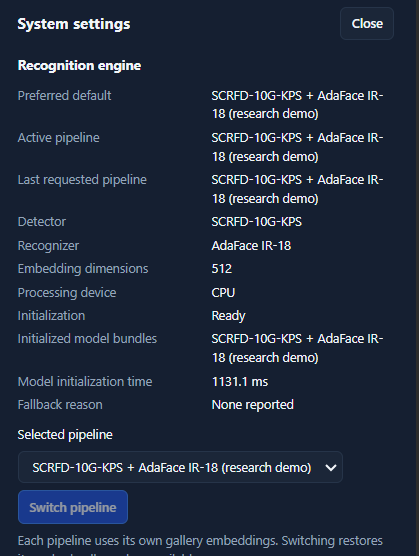

# FaceFind system design

**Frozen application** [`9734b203f524670b695e85b0ea2088f4c6794517`](https://github.com/aksarwar8/FaceFind/commit/9734b203f524670b695e85b0ea2088f4c6794517)

[Generated Archify diagram](docs/architecture/facefind.html) · [Editable Archify specification](docs/architecture/facefind.architecture.json) · [Artifact provenance](#archify-artifact)

[Requirements](#system-context-and-requirements) · [System diagram](#high-level-architecture) · [Decisions](#architecture-decision-records) · [Enrollment](#enrollment) · [Inference](#group-photo-inference) · [Matching](#open-set-recognition-decisions) · [Data and state](#conceptual-data-model) · [Evaluation](#evaluation-studio) · [Reliability](#reliability-and-failure-recovery) · [Deployment](#reproducibility) · [API](#api-contracts)

## Executive architecture summary

FaceFind enrolls named references, identifies people in an unseen group photo, and returns an annotated image and per-face results. A photo can contain people outside the gallery, so recognition is open set. A strong candidate also needs enough separation from the next candidate before it becomes a confirmed identity. Enrollment lets the operator resolve ambiguous references. Evaluation Studio scores a completed analysis against independent annotations.

The implementation is a local client–server application. A modular browser frontend talks to a single FastAPI worker on the same workstation. The worker hosts inference and gallery state in memory. The browser owns the current workflow and independent evaluation. Runtime inference needs neither an internet connection nor a hosted model endpoint.

### Architecture at a glance

| Area | Implementation |
|---|---|
| Deployment | One trusted operator, one workstation, a browser and one Python FastAPI worker over loopback HTTP |
| Browser | Locally served HTML, CSS and JavaScript modules for Dashboard, Gallery, Analyze, Settings and Evaluation Studio |
| CPU inference | OpenCV for image operations, YuNet and SFace. The optional research bundle uses an InsightFace SCRFD adapter and ONNX Runtime for AdaFace |
| Pipeline choice | SCRFD-10G-KPS + AdaFace IR-18 preferred when available. Bundled YuNet + SFace is the independent startup path and normal fallback |
| Reference workflow | Validate and detect, review ambiguous candidates when needed, align and embed into the active gallery |
| Gallery state | Process-local cache keyed by pipeline, with normalized vectors, bounded review images and revision identifiers |
| Analysis workflow | Detect, align, embed and match. Resolve duplicate claims and return structured results and an annotated JPEG |
| Independent evaluation | Freeze the analysis in browser memory. Import ground truth or verify manually, pair faces, score outcomes and export a separate report |

## System context and requirements

### Assignment requirements

| Requirement | Architectural response |
|---|---|
| Select a folder of about 50 filename-labeled reference identities | Gallery workspace uploads local files. The backend validates identity stems, enrolls usable references and reports rejected or pending files. |
| Upload an unseen group photograph | Analyze previews and submits a local file through the loopback API. |
| Identify enrolled people and mark unenrolled people Unknown | Pipeline-specific similarity and margin rules establish an accepted match or an unassigned outcome. |
| Show labels on the photograph and provide a results list | The server produces annotated JPEG and structured rows. Analyze links the image and result list. |
| Operate offline on a laptop with an accessible workflow | Local browser assets, CPU models and explicit Gallery and Analyze workspaces. [Assignment compliance](docs/verification/COMPLIANCE.md) |

### Additional engineering design drivers

| Driver | Architectural response |
|---|---|
| Human control over enrollment | Keep candidate previews and a strict review path. Smart selection is optional and correctable. |
| Independent evaluation | The browser holds frozen predictions and separately ingests truth with provenance. Recognition works without annotations. |
| Reproducibility and CPU compatibility | Freeze the application revision, record the active pipeline and rules in each result, and ship a runnable bundled path. |
| Resource-bounded ingestion | Limit request size, file count, decoded pixels, working geometry and retained review images. |
| Local privacy | Use same-origin loopback, retain biometric state in the process, and return image and analysis responses with cache restrictions. |
| Failure recovery and predictable state | Expose engine readiness and fallback. Serialize POST handlers and reject stale pipeline, gallery or review references. |

## High-level architecture

~~~mermaid
flowchart TB
    Operator["Operator"] --> Browser
    Truth["Independent annotations or manual correspondence"] --> Studio

    subgraph Client["Browser process · local workstation"]
        Browser["Dashboard / Gallery / Analyze / Settings"]
        Frozen["Frozen analysis + gallery membership"]
        Studio["Evaluation Studio · normalize, pair, score"]
        Reports["Evaluation CSV / JSON / JPEG"]
        Browser -->|"Completed Analyze result"| Frozen --> Studio --> Reports
    end

    subgraph Server["FastAPI worker process · same workstation"]
        API["API handlers · Host / Origin checks · POST lock"]
        Decode["Bounded uploads · decode and orient"]
        Registry["Pipeline registry · initialize or restore"]
        Choice{"One active bundle per operation"}
        Research["SCRFD + AdaFace"]
        Bundled["YuNet + SFace"]
        ML["Detect, align, embed · match on Analyze"]
        Gallery["Process-local galleries and review state · keyed by pipeline"]
        Output["Enrollment / status or structured inference + JPEG"]
        API -->|"Image upload"| Decode --> Choice
        API -->|"Startup and selection state"| Registry --> Choice
        Choice --> Research --> ML
        Choice --> Bundled --> ML
        ML -->|"Enrollment writes through API handlers"| Gallery
        Gallery -->|"Analyze reads active gallery"| ML
        ML --> Output
        API -->|"Status and review responses"| Output
    end

    Browser -->|"Same-origin loopback HTTP"| API
    Output -->|"HTTP response"| Browser
~~~

The browser uses HTTP responses to observe backend state. The gallery stays inside the worker. Pipeline branches show alternatives selected by the registry. Only the active bundle handles the operation. Ground truth enters Evaluation Studio directly in the browser and never crosses the inference API boundary.

## Components and boundaries

| Component | Responsibility |
|---|---|
| [app.py](app.py) | FastAPI lifespan, model startup, process caches, static UI delivery and serialization of local API mutations. |
| [api/routes.py](api/routes.py), [api/images.py](api/images.py), [api/upload_route.py](api/upload_route.py), [api/annotations.py](api/annotations.py) | Bounded multipart uploads, shared image decoding, gallery enrollment and review, thumbnails, pipeline selection, analysis, annotation and status. |
| [face_engine/configuration.py](face_engine/configuration.py) | Pipeline registry, lazy bundle construction, initial fallback and restoration of the selected pipeline's gallery. |
| [face_engine/pipeline.py](face_engine/pipeline.py) | Per-face orchestration, matching, duplicate handling and stage timings. |
| [face_engine/research_models.py](face_engine/research_models.py) | SCRFD CPU detector, AdaFace alignment and embedding, calibrated AdaFace matcher. |
| [detector.py](face_engine/detector.py), [embedder.py](face_engine/embedder.py), [match.py](face_engine/match.py) | Bundled OpenCV YuNet detector and SFace adapter and matcher. |
| [web](web/) | Persistent shell and hash navigation, dashboard, gallery, viewer, settings, safe DOM rendering and client-side exports. Evaluation modules separate import validation, assignment and scoring, rendering, and report generation. |
| [scripts/evaluation](scripts/evaluation/) and [tests](tests/) | Benchmark, calibration, verification and regression code. The production SCRFD adapter reuses the evaluator's detector factory. The benchmark runners remain separate from normal requests. |
| [models/face](models/face/) | Tracked YuNet and SFace checkpoints and notices. Restricted optional checkpoints belong in the ignored `data/private/models/` directory. |

### Technology rationale

Python keeps HTTP validation and native numerical libraries in the same process. FastAPI supplies typed request contracts, multipart handling and a lifespan hook for model initialization. Browser modules give the reviewer a visual workflow without requiring a frontend build service or a separate hosted application. OpenCV provides detection, alignment and image operations, while the optional AdaFace adapter checks its input and output shapes and selects ONNX Runtime’s CPU provider.

Process-local matrices and exact NumPy scoring fit the assignment gallery. They avoid a database service, a persistence policy for face vectors and an approximation step in candidate ranking. These are present-day architectural comparisons. The [decision records](#architecture-decision-records) describe when a different design would warrant evaluation.

## System Settings in the running application

The cropped drawer records one run with SCRFD + AdaFace active and ready on CPU. Bundled-model fallback and pipeline switching were verified separately. [Release verification](docs/verification/RELEASE.md)

## Architecture Trade-offs

| What we chose | What we gave up | Why |
|---|---|---|
| Local FastAPI and CPU inference | A hosted GPU service and its lower potential inference latency | The demo must run offline on one laptop. |
| Bundled YuNet + SFace with an optional preferred research bundle | A single-model installation with uniform behavior across machines | The bundled path starts without restricted checkpoints, while users can supply the preferred checkpoints subject to their applicable terms. |
| Process-local gallery and one worker | Durable enrollment and shared state across workers | Local vector reuse keeps the deployment small. |
| Manual review and optional Smart selection | Fully automatic enrollment in ambiguous cases | A person's enrollment intent can differ from the highest-scoring or largest detected face. |
| Independent browser evaluation of frozen inference | Annotation-guided changes to predictions during scoring | Correctness must be assessed against separately supplied evidence. |

## Architecture decision records

These records pair the deployed choice with evidence and a trigger for revisiting it. Rationale is retrospective where the [collaboration record](AI_COLLAB.md) does not document a historical decision.

| Context | Implemented decision and benefit | Trade-off and revisit trigger | Evidence |
|---|---|---|---|
| Runtime must work offline on a laptop | Run model inference on local CPU. Use native OpenCV and ONNX-backed adapters. | The preferred bundle costs more CPU time. Revisit execution settings after stage profiling or if the target CPU changes. | [Timing](RESEARCH.md#application-timing) · [Offline acceptance](docs/verification/RELEASE.md#developer-performed-disconnected-network-acceptance) |
| Gallery mutations need one authority | Use one FastAPI process with a POST lock, so state and precondition checks share a consistent owner. | POSTs serialize and the worker has no shared-state coordination. Revisit if measured contention or concurrent operators become requirements. | [Middleware](app.py) · [Lifecycle tests](tests/test_gallery_api_lifecycle.py) |
| Operator needs a visual workflow with local assets | Serve modular browser JavaScript alongside the API. Isolate workspace, API and evaluation logic. | More browser state and accessibility behavior are maintained directly. Revisit if UI complexity or cross-browser defects grow materially. | [Browser modules](web/) · [Frontend tests](tests/test_desktop_frontend.mjs) |
| Preferred checkpoints and runtime are optional | Offer two bundles with startup fallback, explicit selection and observable readiness. | Two runtime contracts and matching policies require separate verification. Revisit if portability, model quality or checkpoint terms change. | [Registry](face_engine/configuration.py) · [Startup tests](tests/test_pipeline_startup.py) |
| Different embedders define distinct vector spaces | Key gallery and pending caches by pipeline, and restore only compatible state on switch. | A gallery must be enrolled per bundle. Revisit cache identity if multiple versions of the same bundle become selectable. | [Activation code](face_engine/configuration.py) · [Lifecycle tests](tests/test_gallery_api_lifecycle.py) |
| Enrollment is session-scoped | Hold gallery vectors, thumbnails and review images in memory. | A process restart loses enrollment. Revisit persistence if rebuild costs are material and consent, retention and deletion requirements are defined. | [Process state](app.py) · [Enrollment handlers](api/routes.py) |
| Reference gallery is small | Score all stored vectors by cosine similarity and rank exact scores. | Compute and memory grow with gallery size. Revisit indexed retrieval only if profiling shows matching is a material bottleneck. | [SFace matcher](face_engine/match.py) · [AdaFace matcher](face_engine/research_models.py) |
| SCRFD missed references at its standard input scale | Retry empty gallery detections at 640 px while preserving the standard group-analysis path. | A second pass adds cost when invoked. Revisit after validation on unseen references with small faces and distractors. | [Adaptive enrollment evidence](RESEARCH.md#engineering-case-studies) |
| Detection does not establish enrollment intent | Offer strict review and a correctable dominant-face heuristic. | Review adds operator work. Revisit automation only with measured intended-face errors and review burden on representative data. | [Selection policy](face_engine/reference_selection.py) · [Case studies](RESEARCH.md#engineering-case-studies) |
| Review queue position can shift | Address review items by immutable IDs and track embedding revisions separately. | The client needs stale-state recovery. Revisit the protocol if state ownership or persistence changes. | [Lifecycle tests](tests/test_gallery_api_lifecycle.py) |
| Recognition output needs independent correctness checks | Score frozen predictions in the browser against separate ground truth. | Unsaved work clears on reload. Revisit storage only if longer evaluation sessions require it and a local data policy permits it. | [Evaluation modules](web/evaluation.js) · [Scoring tests](tests/test_evaluation_studio.mjs) |

## Model initialization and fallback

The app defaults to `scrfd_adaface` unless `FACEFIND_DEFAULT_PIPELINE` requests another registered pipeline. An invalid name normalizes to the preferred default and produces a note. A model initialization error triggers the alternate pipeline. If both fail, the server remains available for diagnostics. Metadata distinguishes initialization state, requested and active pipeline, initialized bundles and the fallback reason. A bundle can be selectable without being initialized. A failed switch leaves the current bundle and gallery intact because bundle construction precedes activation.

~~~mermaid
flowchart TD
    C[Read configured or preferred pipeline] --> P[Construct requested bundle]
    P -->|Ready| A[Activate bundle and expose status]
    P -->|Initialization failed| F[Construct alternate bundle]
    F -->|Ready| A
    F -->|Initialization failed| U[Serve diagnostics with engine unavailable]
~~~

## Enrollment

1. The browser uploads selected files as multipart data. The server derives identity names from file stems, validates decoded format, size and name, handles duplicates and decodes each image.
2. SCRFD uses its standard 1,280-pixel long-edge cap first. If that gallery pass finds no valid boxes, it retries at 640 pixels with the same score and NMS thresholds. Both passes preserve aspect ratio and stride padding. Boxes and landmarks are mapped back to the working image. YuNet enrollment and group-photo detection continue to use one pass.
3. A single detected face is aligned and embedded on the working image. The normalized vector and a bounded face thumbnail are stored in the active pipeline's process gallery. Zero faces after the applicable passes or a processing failure yields a rejection reason.
4. With multiple detections, the default smart policy enrolls the largest box when its area is at least five times the next-largest, its detector score is at least 0.75, and it has the uniquely highest score. Other multi-face references enter the pending queue. The explicit always-review policy queues all multi-face references. The UI opens the first pending reference automatically. Every pending card is a button for direct access, with a numbered preview, face crops, raw detector scores and confirm/skip controls. Confirm or skip advances the queue, and counters update from the response. Candidate indices follow detector order.
5. A replacement with accepted identities becomes that pipeline's gallery. An all-rejected replacement retains an existing working gallery. A replacement containing only ambiguous valid references can add to the pending queue without evicting the working embeddings. Clearing the gallery removes that pipeline's gallery and pending cache.

The upload summary includes aggregate retry attempts, recovered references and retry milliseconds. SCRFD per-reference records include the detection pass, primary time and retry time when run. A recovered reference can still enter manual review or fail embedding.

An automatic selection records the original choice, area ratio and score in the upload summary and gallery status. The in-memory gallery retains the working image and candidates for optional review under the shared 256 MiB review storage budget. If that budget is full, enrollment reports a storage error for references with multiple candidates. Correcting a choice replaces the embedding and thumbnail in place and advances the gallery revision. The original selection evidence stays available alongside the current choice. The group-photo inference path processes its own detections independently.

Gallery revisions are opaque identifiers, not filesystem paths. Thumbnail requests require the active revision and a valid index and return JPEG with `Cache-Control: no-store`. The POST lock serializes engine-affecting operations within one process. Stale preconditions return 409 before the mutation.

For evaluator-provided folders, use **Always Review Multiple Faces** when correctness takes priority over convenience. The Smart heuristic uses box area and detector score as signals. These signals cannot establish the intended identity. [Measured review trade-offs](RESEARCH.md#engineering-case-studies)

~~~mermaid
flowchart TD
    Upload["Upload files · validate names, duplicates and image content"] --> Primary["Detect with active bundle"]
    Primary --> Retry{"SCRFD primary result empty?"}
    Retry -->|"Yes"| Again["Retry at 640 px · same thresholds"]
    Retry -->|"No"| Count{"Valid faces"}
    Again --> Count
    Count -->|"Zero"| Reject["Reject reference with reason"]
    Count -->|"One"| Commit["Align, embed and enroll"]
    Count -->|"Multiple"| Policy{"Smart enabled and all criteria met?"}
    Policy -->|"Yes"| Record["Retain automatic choice and candidate evidence"]
    Record --> Commit
    Record -->|"Later correction"| Replace["Replace vector and thumbnail · advance revision"]
    Policy -->|"No or strict review"| Pending["Queue candidates with immutable ID"]
    Pending -->|"Confirm"| Commit
    Pending -->|"Skip"| Skip["Remove pending item without changing embeddings"]
~~~

For multiple faces, review-image capacity must be available before retaining candidate evidence. The diagram describes one reference. Batch replacement separately decides whether to install the new gallery or preserve the existing one. [Enrollment handlers](api/routes.py) · [Selection policy](face_engine/reference_selection.py)

## Group-photo inference

Analyze validates the active gallery before processing the original upload. Its output geometry is the oriented, bounded **working image**, which can differ from the raw upload, the model input, and the browser preview.

~~~mermaid
flowchart TD
    File["Original multipart upload"] --> Decode["Pillow decode · EXIF orientation · bounded RGB"]
    Decode --> BGR["OpenCV working raster · H × W × 3 BGR"]
    BGR --> Detect["Active detector · resized input"]
    Detect --> Map["Working-image XYWH boxes and 5 × 2 landmarks"]
    Map --> Align["Five-point alignment on working raster"]
    BGR --> Align
    Align --> Encode["Active embedder · normalize float32 vector"]
    Encode --> Score["Exact gallery scoring and open-set decision"]
    Score --> Resolve["Resolve duplicate claims"]
    Resolve --> Result["Structured response and annotated JPEG"]
~~~

| Transformation | Implementation |
|---|---|
| Decode and orient | [Pillow ingestion](api/images.py) validates decoded content, constrains pixel and edge counts, handles EXIF orientation, converts to RGB and composites transparency against white. Routes convert RGB to BGR for the model adapters. Analysis records the source dimensions and orientation. |
| Detector resize and coordinates | Both detectors cap the long edge at 1,280 px for Analyze and preserve aspect ratio. YuNet sets the input size to the resized raster and divides box and landmark coordinates by its resize scale. SCRFD pads on the right and bottom to multiples of 32, rescales coordinates and clips box corners to the working image. Padding leaves the top-left origin unchanged. The 640 px SCRFD retry applies only to references. |
| YuNet → SFace | Reconstruct the detector row from XYWH, five landmark pairs and confidence. OpenCV `FaceRecognizerSF.alignCrop` handles alignment and `feature` handles model extraction. The adapter flattens the **128-dimensional** feature to float32 and L2-normalizes it. |
| SCRFD → AdaFace | Fit a five-point similarity transform and warp to **112 × 112**. Prepare a conceptual **1 × 3 × 112 × 112** BGR float input using `(pixel − 127.5) / 127.5`. ONNX Runtime executes on CPU. The adapter validates the shape and returns an L2-normalized **512-dimensional** float32 vector. |
| Annotation and response | Render the conflict-resolved rows on the working image, encode a JPEG data URL, and return boxes, scores, statuses, candidate details, timings and provenance. The renderer uses local fonts where supported and a numbered fallback where needed. |

The browser preview endpoint returns a separately bounded PNG. Analyze submits the original file and displays the JPEG and structured results from that request. Per-face processing failures are returned as error rows. A missed detection produces no row. [YuNet detector](face_engine/detector.py) · [SFace embedder](face_engine/embedder.py) · [SCRFD and AdaFace adapters](face_engine/research_models.py) · [Inference orchestration](face_engine/pipeline.py) · [Annotation](api/annotations.py)

## Open-set recognition decisions

Each query embedding and gallery row represents a face in the **active model’s vector space**. For nonzero query $q$ and gallery vector $g_i$, cosine similarity is $s_i = (g_i \cdot q)/(\lVert g_i\rVert_2\lVert q\rVert_2)$. For unit vectors this is their dot product. Both matchers still compute the norms and clip scores to $[-1,1]$. They rank candidates by score, take the best score $s_1$ and second score $s_2$, and compute $\Delta = s_1 - s_2$. A one-identity gallery uses $s_2=-1$ as the implemented sentinel.

| Deployed matcher | Confirmed identity | Other outcomes |
|---|---|---|
| AdaFace | $s_1 \ge 0.26362$ and $\Delta \ge 0.07940$ | Unknown with no assigned identity when either condition fails. |
| SFace | $s_1 \ge 0.50$ and $\Delta \ge 0.12$ | If confirmation fails, **Possible** requires $s_1 \ge 0.35$ and $\Delta \ge 0.087$. It carries the candidate as a tentative identity. Otherwise the result is Unknown with no assigned identity. |

**Hypothetical example.** If SFace scores two candidates at 0.72 and 0.66, the top score clears 0.50 but the margin is 0.06. The margin fails both SFace gates, so the result is Unknown. Cosine measures embedding similarity. Its value should be interpreted as similarity rather than as an identity probability.

The table describes the live rules. AdaFace uses rounded values from the 50-way research calibration. The separately calibrated SFace research operating points do not describe its bundled matcher behavior. [SFace source](face_engine/match.py) · [AdaFace source](face_engine/research_models.py) · [Research calibration](RESEARCH.md#calibration-and-deployed-rules)

**Duplicate claims.** After independent matching, the pipeline groups recognised and Possible claims by identity. It retains the highest score, with earliest detection order breaking ties. An AdaFace conflict loser becomes Unknown. A SFace conflict loser can retain Possible based on the tentative **score** threshold alone in this post-matching path. Otherwise it becomes Unknown. The row identifies the retained face as its conflict target. Evaluation treats Possible as unassigned. [Conflict logic](face_engine/pipeline.py) · [Conflict tests](tests/test_pipeline_conflicts.py)

## Conceptual data model

These entity names describe existing runtime dictionaries and browser records. They are conceptual, with no corresponding persistent database schema.

| Entity | Important fields and relationships | Owner, storage and lifecycle |
|---|---|---|
| Pipeline bundle | ID, detector, embedder, matcher, initialization time. Registry selects one active bundle. | Worker memory. Constructed on first use and cached until process restart. |
| Gallery state and revision | Pipeline ID, opaque revision, identity names, aligned matrix rows, thumbnails, automatic-review records and status. | Worker memory by pipeline. Successful replacement, confirmed enrollment and changed correction install or advance the embedding revision. Clear removes the active gallery. |
| Identity and normalized embedding | Filename-derived identity name and a corresponding float32 vector in the bundle’s space, with an optional thumbnail. | Matrix and name list in the gallery. Removed on replacement or clear. Correction updates the vector in place. |
| Pending review item | Immutable ID, identity, working image and candidates with boxes, landmarks and scores. | Worker’s pipeline-specific pending cache. Confirmation or skip consumes the item. Refresh is required after an ID becomes stale. |
| Automatic review item | Immutable reference ID, retained working image, candidate list, original/current choice and selection evidence. | Worker gallery review state under the shared byte limit. Correction validates the current gallery revision. Replacing or clearing the gallery removes the prior automatic-review records. |
| Analysis snapshot | Analysis ID, image SHA-256 and geometry, pipeline ID, gallery revision and membership, recognition rules and predictions. | Browser memory after Analyze. Replacing the input or analysis, or observing incompatible engine/gallery state, invalidates the prior snapshot. |
| Ground-truth annotation | Image filename or hash, face ID, actual identity/status and optional box with coordinate metadata. | Browser import or manual review. Scoped to a current analysis and cleared with it or on reload. |
| Evaluation correspondence | Prediction-to-annotation pairs and unmatched rows, with IoU for boxed assignment or explicit manual labels. | Computed in browser for current truth and predictions. Recomputed when the association or truth changes. |
| Evaluation report | Analysis and truth provenance, correspondence outcomes, metric counts and scope. | Browser result until invalidation or reload. An exported file is an operator-owned copy and outlives the session. |

Vector dimension is a shape check, while pipeline ownership is an embedding-space check. Even two models with equal dimensions can encode faces differently. FaceFind compares only against the gallery of the active bundle. [Registry](face_engine/configuration.py) · [Worker state](app.py) · [Gallery routes](api/routes.py) · [Evaluation data](web/evaluation-core.js)

## State management and concurrency

The worker owns the bundles, galleries and review items. One process lock wraps API POST handlers. When a request supplies `X-FaceFind-Pipeline` or `X-FaceFind-Gallery`, the server checks those preconditions inside that lock before calling the handler. A mismatch returns HTTP 409. Review operations also check the addressed immutable item and, for automatic correction, the applicable embedding revision. Reads are separate from the serialized POST path.

Browser navigation keeps valid results in memory. The client refreshes state after a stale response and discards the old result when the active pipeline or revision changes or cannot be validated. Concurrent tabs share the worker’s state. The deployment assumes a single operator and a single worker.

| Event | Worker state | Browser consequence |
|---|---|---|
| Successful replacement, pending confirmation or changed automatic correction | Installs gallery contents or advances embedding revision | Prior analysis and evaluation become stale when the new state is adopted |
| Pending skip or same-choice correction | Embedding revision stays unchanged. Skipping removes the pending item | Queue refresh can preserve a still-compatible analysis |
| All-rejected replacement or failed switch | Existing working gallery retained | User can recover without rebuilding the previous gallery |
| Successful pipeline switch | Restores that bundle’s compatible gallery and pending cache, or activates empty state | Previous pipeline’s analysis is invalid |
| Clear active gallery | Removes active gallery and pending cache | Prior results invalidate and Analyze requires enrollment |
| Browser reload | Worker state remains until restart | In-memory input, predictions and unsaved evaluation clear |
| Worker restart | In-memory bundles and gallery caches clear. Startup initializes a requested or fallback bundle | Re-enroll references. A subsequent refresh cannot validate the previous snapshot |

~~~mermaid
sequenceDiagram
    participant X as Browser tab A
    participant Y as Browser tab B
    participant S as One FastAPI worker
    X->>S: Confirm immutable ID
    S-->>X: Enrollment and new revision
    Y->>S: Confirm stale item or stale preconditions
    S-->>Y: HTTP 409, no mutation
    Y->>S: Refresh gallery status
    S-->>Y: Current queue and revision
~~~

[Request guards](app.py) · [Browser state](web/app.js) · [Lifecycle tests](tests/test_gallery_api_lifecycle.py)

## Evaluation Studio

Prediction counts describe system output. Establishing correctness requires independent evidence of which faces and identities were present. The Analyze endpoint includes provenance fields for the completed result. These are a unique analysis ID, a streamed SHA-256 of the uploaded image, source geometry including EXIF orientation, the gallery identity snapshot, and the matcher's active thresholds and margins. The pipeline still receives only the image, gallery and model configuration.

The browser freezes a copy of the completed response, including the gallery membership snapshot. It keeps the current photo preview separately for display and manual review. Ground-truth files are read and validated in the browser. They are never uploaded or sent to the detection or recognition pipeline. Imported annotations, manual labels, and reports are scoped to the analysis ID, gallery revision and pipeline. Changes to any of these invalidate evaluation. Browser reload clears unsaved work.

~~~mermaid
flowchart LR
    A[Completed analysis and identity snapshot] --> F[Frozen result]
    T[Independent manual or imported truth] --> V[Validate association and coordinates]
    V --> P[One-to-one IoU or manual correspondence]
    F --> P
    P --> M[Outcome counts and conditional and end-to-end rates]
    M --> X[Browser dashboard and report exports]
~~~

### Input schemas and coordinate handling

| Format | Fields |
|---|---|
| Canonical CSV | `image_filename` or `image_sha256`, `face_id`, `actual_identity`, optional `status`, and `bbox_x`, `bbox_y`, `bbox_width`, `bbox_height` |
| Canonical JSON | A face array or an object with a `faces` array. Use the same fields, or use `bbox: [x, y, width, height]`. `image_id` can carry the SHA-256. |
| Local demo CSV | `group`, `face_number`, `source_identity`, `status` and the four `bbox_*` fields. The importer does not use `expected_label` to decide membership. |
| Local demo JSON | Uses the `faces` array plus `groups[].image`, `sha256`, `canvas_width`, `canvas_height`, and the expected face count. Imported composite boxes are marked approximate. |

Use basenames without directories. Exact file hashes are checked where supplied. Filename-only annotations require the evaluator to confirm the file corresponds to the analyzed photograph. Matching uses a case-insensitive basename and rejects ambiguous associations. Use `image_width` and `image_height` together if the coordinates are on a resized canvas. `coordinate_space` defaults to `oriented`, meaning the original image after EXIF orientation. Use `raw` for pre-orientation coordinates or `working` for the analysis image. The importer transforms box corners then maps the result to analysis pixels. The photo preview overlays use normalized coordinates. Ground-truth files are capped at 2 MiB and IoU assignment at 256 predictions and 256 actual faces per image. Missing or unreliable boxes require manual one-to-one correspondence. Mark a box unreliable using `box_reliable=false`.

### Matching and metrics

Imported boxes match predictions one-to-one at IoU >= 0.50. Assignment maximizes the number of valid matches, then total IoU, using deterministic prediction order and sorted annotation IDs for ties. TP counts matched detections, FP counts extra detections, and FN counts missed annotations. Detection precision is TP/(TP+FP), recall is TP/(TP+FN), and F1 is 2TP/(2TP+FP+FN). Complete manual reviews use the same counts from explicit correspondence without IoU.

| Metric | Numerator | Denominator |
|---|---|---|
| End-to-end known identification | Correct enrolled identity assignments | All annotated known faces |
| End-to-end unknown rejection | Unenrolled faces with no confirmed assignment | All annotated unknown faces |
| End-to-end false acceptance | Unenrolled faces assigned an enrolled identity | All annotated unknown faces |
| End-to-end known identification failure | Known faces with any unsuccessful outcome | All annotated known faces |
| Overall correct outcome | Correct known IDs plus correct unknown rejections | All annotated faces |
| Conditional known identification | Correct enrolled identity assignments | Matched known faces with valid recognition outcomes |
| Conditional unknown rejection | Correct rejections | Matched unknown faces with valid recognition outcomes |

A zero denominator is N/A. A missed face or processing failure is unsuccessful end to end and outside the conditional denominator. Unknown rejection requires a matched face and a usable recognition outcome. An absent detection or failed embedding provides neither. A Possible prediction is tentative and scored as unassigned. An accepted label on an extra detection is visible in its row and does not enter person-level false acceptance. Partial manual recognition denominators describe only verified labels and marked misses. JSON and CSV expose provenance, raw prediction status, outcome, scores, coordinates and metric numerators and denominators. The JPEG labels evaluation outcomes separately from the normal recognition image.

## Reliability and failure recovery

| Failure | Detection | Response and retained state | Operator-visible outcome and verification |
|---|---|---|---|
| Preferred model, dependency or checkpoint unavailable | Requested bundle construction raises during startup | Attempt the alternate bundle. Activate it only after successful construction. | Active engine and fallback reason in health/status. [Startup tests](tests/test_pipeline_startup.py) |
| Both bundles unavailable | Both initialization attempts fail | Leave engine inactive and keep the server available for diagnostics. | Engine-unavailable status. Gallery upload returns 503 without an engine. [Startup tests](tests/test_pipeline_startup.py) |
| Invalid or corrupt image | Content inspection, geometry checks or decode fails | Reject Analyze/preview input. Gallery reports the failed reference and continues processing other files. | Actionable decode error or reference-level rejection. [Image tests](tests/test_image_ingestion.py) |
| Oversized upload | Declared/streamed request bytes, per-file bytes or decoded pixels exceed limits | Abort oversized requests or reject the affected gallery file. A failed replacement preserves a working gallery. | HTTP 413 where the request fails at the boundary, or a per-file gallery error. [Upload tests](tests/test_image_ingestion.py) |
| Corrupt or truncated multipart request | Parser raises or never sees a closing boundary | Reject it before the enrollment/analysis handler and close parser-owned files. | HTTP 400 for detected multipart parsing errors. [Upload tests](tests/test_image_ingestion.py) |
| Empty gallery | Active gallery has no enrolled names | Stop Analyze before inference. | HTTP 400 asking for a reference gallery. [Analyze handler](api/routes.py) |
| Ambiguous reference | More than one usable detection, and strict review or Smart criteria unmet | Queue candidates if review storage is available. Wait for explicit confirmation or skip. | Pending preview, or a storage error when over budget. [Policy](face_engine/reference_selection.py) · [Lifecycle tests](tests/test_gallery_api_lifecycle.py) |
| Failed gallery replacement | No new reference enrolled | Preserve active embeddings. A pending-only replacement can append candidates. | Per-file outcomes and retained gallery status. [Lifecycle tests](tests/test_gallery_api_lifecycle.py) |
| Stale review or request | Pipeline/revision preconditions disagree, or review ID no longer resolves | Return HTTP 409 without the requested mutation. Browser refreshes current state. | Refresh or reopen the current candidate. [Two-tab scenario](#state-management-and-concurrency) |
| Failed model switch | Requested known bundle cannot be constructed | Construction happens before activation, so the current bundle and gallery stay active. | HTTP 503 with a sanitized initialization error. [Startup tests](tests/test_pipeline_startup.py) |
| Unsupported image codec | Decoder registration or actual input format is unsupported | Reject the upload or affected reference. Advertise formats supported in the current runtime. | HTTP 415 on single-photo routes, or per-file gallery rejection. [Image ingestion](api/images.py) |
| Invalid evaluation annotations | Browser checks schema, identity membership, image association and coordinates | Refuse invalid annotations and leave inference unchanged. | Import error and correction path. [Evaluation tests](tests/test_evaluation_studio.mjs) |
| Stale analysis snapshot | New photo/analysis, or active pipeline/revision can no longer validate the result | Invalidate linked analysis/evaluation state on the client. | Run Analyze again and attach truth to the new result. [Browser state](web/app.js) · [Release verification](docs/verification/RELEASE.md#evaluation-studio-verification) |

## Performance engineering

The worker constructs each bundle on its first successful initialization and reuses it within that process. Enrollment precomputes gallery embeddings once per enrolled identity and pipeline. Analyze computes new query embeddings and reuses the active gallery matrix. Resizing bounds detector work separately from image decoding and alignment. A 640 px SCRFD reference retry adds one detection pass on empty valid primary results, with its own timing counters. [Retry evidence](RESEARCH.md#engineering-case-studies)

For $F$ detected faces, $N$ gallery rows and embedding dimension $d$, straightforward exact comparison takes $O(FNd)$ for the vector comparisons. The current matchers also compute norms and sort scores per face, with $O(FN \log N)$ sorting work. **Illustration:** 10 faces × 50 identities gives 500 pairwise scores. That is approximately 64,000 component products at $d=128$ or 256,000 at $d=512$, before accounting for normalization, sorting and other stages. These are work estimates, not latency measurements. At this scale, local exact search keeps candidate ranking simple and needs no index or vector database.

| Warm mean, ms | Detection | Alignment | Embedding | Matching | Annotation/render | Backend | Full API request |
|---|---:|---:|---:|---:|---:|---:|---:|
| YuNet + SFace | 65.0 | 5.2 | 181.7 | 2.4 | 105.8 | 462.6 | 552.7 |
| SCRFD + AdaFace | 405.1 | 15.1 | 505.4 | 3.3 | 96.1 | 1,151.9 | 1,257.4 |

These saved means use five warm loopback requests per bundle on one genuine group photo without identity annotations. The resulting galleries and detection counts differ. Detection and embedding account for much more of the measured latency than matching in that workload. The annotation interval covers drawing, JPEG encoding and base64 conversion. Backend and request totals also include work outside the named stages. The collected instrumentation does not isolate JSON serialization or fully explain the remainder. Browser-observed request latency is a separate client measurement. [Timing protocol and remainders](RESEARCH.md#application-timing)

Consider optimized exact search or indexing only when a larger enrolled cohort shows a material matching bottleneck in stage profiles. Compare p95, memory, ranking agreement and open-set errors before choosing an index.

## Security and privacy

The service is intended for one desktop operator. It has no per-user authentication or multi-worker gallery coordination. The launcher binds to loopback. API requests require local Host and, if supplied, the matching Origin. The web interface uses local assets and writes untrusted labels as DOM text. Uploads can spool to temporary files, which the parser and route close. Retained gallery vectors and review crops live in worker memory. Browser-side evaluation lives in tab memory. The operator owns files created by export and controls their retention and sharing. The local deployment has neither authentication nor coordinated tenant isolation. Closing files is resource cleanup rather than a secure-deletion guarantee. Model rights and dataset redistribution terms remain separate. [Rights register](models/face/MODEL_LICENSES.md)

| Scenario | Handling | Verification | Remaining limitation |
|---|---|---|---|
| Large upload or exhausted review storage | Default 100 MiB/file, configurable 1–512 MiB. Gallery capped at 128 files and 2 GiB/request; individual photo request budget is the file cap plus 2 MiB. Part headers capped at 16 KiB. Shared candidate-review storage capped at 256 MiB. | [Parser and image tests](tests/test_image_ingestion.py), [release evidence](docs/verification/RELEASE.md) | Resources remain finite in the worker and OS. |
| Truncated multipart or corrupt image | Bounded parser spools above 256 KiB, offloads rollover and closes incomplete uploads. Image decoder validates content and bounds decoding to 48 MP, then works within 16 MP and 8,192 px edge limits. | [Image tests](tests/test_image_ingestion.py) | Optional formats depend on installed decoders. |
| Missing or invalid checkpoint | Startup fallback and diagnostics. Failed interactive switch preserves current state. | [Startup tests](tests/test_pipeline_startup.py), [public clone smoke](docs/verification/RELEASE.md) | Preferred weights require authorization and setup. |
| Stale reference or gallery mutation | Immutable ID and available preconditions are checked before mutation. Correction also checks embedding revision. | [Lifecycle tests](tests/test_gallery_api_lifecycle.py), Chrome two-session recovery | Process-wide shared state in one worker. |
| Incorrect truth association or malformed annotations | Browser checks filename or hash, IDs, bounds and membership. Manual correspondence for unavailable boxes. | [Evaluation regressions](tests/test_evaluation_studio.mjs) | Basename-only association requires evaluator verification. |
| Upload-stack advisories | Patched Pillow, Starlette and python-multipart pins; compatible FastAPI version. | [Advisory and compatibility record](docs/verification/RELEASE.md#final-hardening-verification) | Ongoing maintenance remains necessary. |
| Crossing the local boundary or retaining previews in caches | Same-origin checking, bounded private routes and `Cache-Control: no-store` on API responses. | [API boundary tests](tests/test_local_api_boundary.py) | No protection against another trusted local process. |
| Spreadsheet-formula injection | Shared CSV cell escaping and prefixing for potentially executable values. | [Frontend regressions](tests/test_desktop_frontend.mjs), [evaluation tests](tests/test_evaluation_studio.mjs) | Export is user-controlled; review downstream sharing. |
| Unsupported Unicode JPEG labels | Local font rendering with numbered fallback and full Unicode structured results. | [Annotation tests](tests/test_annotations.py) | Shaped Bengali and Hindi rendering was skipped on the tested Windows wheel. |

## Reproducibility

Use the [bundled quick start](README.md#installation-and-first-run) for the release at the head of this document. The clean Windows Python 3.11.9 clone ran normal analysis without ground truth, automatically fell back to YuNet + SFace and loaded Evaluation Studio. [Verification and limits](docs/verification/RELEASE.md)

For the optional CPU demo configuration, use the same Python 3.11 environment:

~~~powershell
python -m pip install -r requirements-local-demo.txt
python -m pip install --no-deps insightface==2.1
~~~

The [base pins](requirements.txt) include NumPy 1.26.4 and OpenCV contrib 4.10.0.84. The [optional pins](requirements-research.txt) include ONNX Runtime 1.32.0, ONNX 1.23.2, scikit-image 0.26.0, SciPy 1.17.1 and ml_dtypes 0.5.4. InsightFace declares `opencv-python`, but the documented separate installation preserves one `cv2` provider. The packaging metadata warning can remain despite working inference.

Only after obtaining authorization, place `scrfd_10g_bnkps.onnx` and `adaface_ir_18_webface4m_yakhyo.onnx` under the ignored `data/private/models/` directory. Remove the PowerShell override with `Remove-Item Env:FACEFIND_DEFAULT_PIPELINE -ErrorAction SilentlyContinue` or explicitly set it to `scrfd_adaface`; restart Uvicorn. Startup never downloads weights. [Exact checkpoint hashes and terms](models/face/MODEL_LICENSES.md)

## Architectural evolution

These options are future work, prioritized by evidence needed to justify a change. [Research validation plan](RESEARCH.md#future-research-and-validation)

| Priority and current constraint | Candidate evolution | Evidence needed |
|---|---|---|
| 1 · CPU stage costs and tested Windows environment | Profile detector/embedding providers and candidate optimization on additional machines. Extend OS, codec and font coverage. | Cold/warm stage timings, p95, peak memory, recognition agreement and platform parity for ingest, UI and exports. |
| 2 · Single reference embedding per name | Evaluate multiple references and quality-aware aggregation within each pipeline. | Held-out retrieval and open-set calibration by reference quality, plus enrollment effort and memory. |
| 3 · Enrollment lost on worker restart | Evaluate local persistence with explicit consent, retention, deletion and model/version compatibility. | Measured re-enrollment cost and a reviewed data policy, then recovery and deletion tests. |
| 4 · Serialized POST work and exact search | Evaluate concurrent execution or larger-gallery retrieval only for measured queue or matching contention. | Peak memory, tail latency and consistency under concurrent work. For indexing, also verify candidate agreement and open-set decisions. |

## API contracts

All paths below are under `/api`. Request schema errors can return 422. Operations supplied with stale `X-FaceFind-Pipeline` or `X-FaceFind-Gallery` preconditions return 409. FastAPI's structured error body normally contains `detail`.

| Method and route | Request | Main response and conditions |
|---|---|---|
| GET `/health` | None | Application and engine initialization, active pipeline ID, fallback/startup error. Can return HTTP 200 with engine unavailable. |
| GET `/status` | None | Gallery state, identities/counts, pending list, build errors and timings, thumbnail indices and revision, active pipeline, readiness, and image upload policy. |
| GET `/pipeline` | None | Available options, requested and active IDs, detector, recognizer, dimensions, device, model initialization timings and fallback information. |
| POST `/pipeline` | JSON `pipeline_id` | Selected pipeline and gallery status, initialization time. 400 for unknown ID, 503 if the known bundle fails to initialize. |
| POST `/gallery` | Repeated multipart `files`, optional `reference_selection_policy` (`smart` by default or `always_review`) | Build success, gallery status and per-upload outcomes, including pending and automatic counts. 503 when no engine is initialized. Individual rejected references normally return a successful HTTP response with outcome details. |
| GET `/gallery/pending/{pending_id}` | Immutable string ID, optional `interactive=true` | Identity, filename, count and preview. Interactive mode adds a clean photograph, dimensions, and ordered candidate crops, bounding boxes and detector scores. UI labels are one-based and selection indices remain zero-based. 409 for a stale ID, 500 if encoding fails. |
| POST `/gallery/select` | JSON `pending_id`, `face_index`, optional `expected_identity` | Updated gallery, pending list and selection timing. 400 for invalid selection, 409 for a stale ID, stale identity or duplicate, 500 if extraction fails. |
| POST `/gallery/skip` | JSON `pending_id`, optional `expected_identity` | Updated gallery and pending list. 409 for a stale ID. |
| GET `/gallery/automatic/{revision}/{reference_id}` | Gallery revision and immutable reference ID | Interactive candidate preview for an automatically enrolled reference. 409 for a stale ID or revision. |
| POST `/gallery/automatic/{reference_id}` | JSON `revision`, `face_index` | Updated gallery status. Changing the selected face updates the gallery revision. 400 for an invalid candidate, 409 for a stale ID or revision or 500 if extraction fails. |
| POST `/gallery/clear` | No payload required | Updated empty status for the active pipeline. |
| GET `/gallery/thumbnail/{revision}/{index}` | Path revision and index | Small JPEG or 404 for stale or unavailable thumbnail. |
| POST `/image/preview` | Multipart `file` | Oriented, bounded PNG data URL and preview dimensions. Uses the same content, decode and resource checks as analysis. |
| POST `/analyze` | Multipart `file` | Annotated JPEG data URL, working image dimensions, results per face, summary, timings, image hash and geometry, frozen gallery identity list, analysis ID and active matching rules. 400 for invalid image or missing gallery, 409 for incompatible gallery, 413 for oversized input, 415 for unsupported content, 500 for JPEG encoding failure. |

## Archify artifact

The [editable specification](docs/architecture/facefind.architecture.json) and [generated HTML](docs/architecture/facefind.html) are the genuine Archify outputs for the published implementation. Archify 3.3.0 validated, delivered and checked the final Evaluation Studio diagram on November 24, 2026. Its automated browser gate passed. The HTML SHA-256 is `4b97dbe5bf257ead7c58ff0e45425014c3e51e94b1518a3fdf031455efe072c7`.

With the [official Archify tooling](https://raw.githubusercontent.com/tt-a1i/archify/main/llms.txt) installed, run from the project root:

~~~powershell
node $archifyCli finalize architecture docs/architecture/facefind.architecture.json docs/architecture/facefind.html --quality showcase --json
~~~

The generator receives the component and flow specification only. It receives no photographs, annotations, embeddings, weights or chat transcripts. The documentation revision preserves the published artifact byte for byte. The diagram's browser gate is separate from the FaceFind browser workflow checks.
