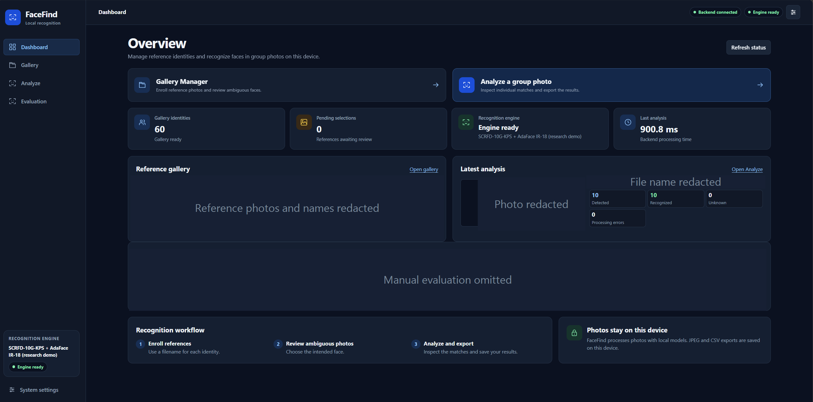
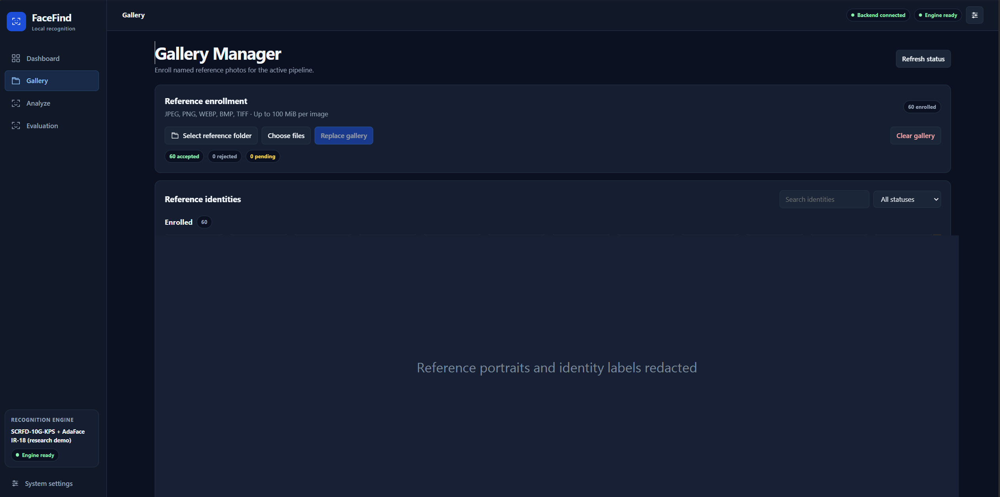
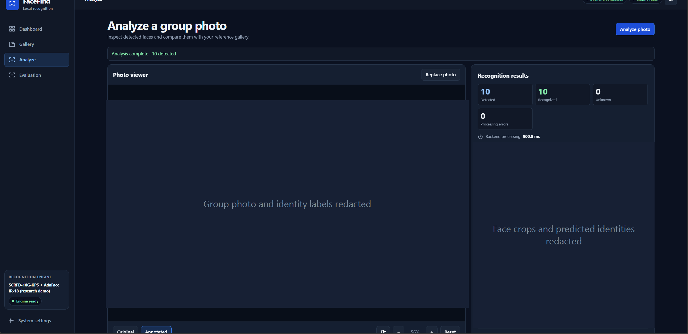
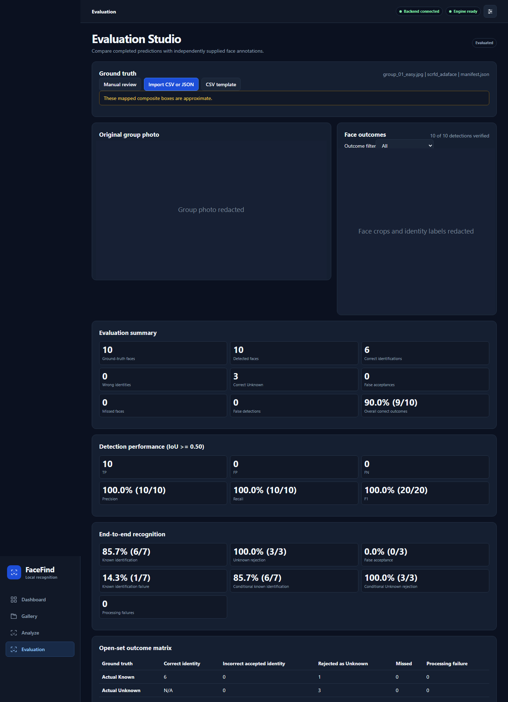

# FaceFind

**Offline Open-Set Face Identification for Group Photographs**

Built for Industry.AI Task A, *Who Is in the Photo?* Enroll a folder of named reference photos, then identify people in an unseen group photo on a local CPU. FaceFind shows accepted names and **Unknown** outcomes, with tentative matches where the active pipeline supports them. Evaluation Studio can independently score those predictions against ground truth.

[Quick Start](#installation-and-first-run) · [Research](RESEARCH.md) · [Architecture](ARCHITECTURE.md) · [AI Collaboration](AI_COLLAB.md) · [Technical Presentation](docs/presentation/README.md)

## Installation and first run

Install **Git** and **Python 3.11**. The commands below use the YuNet and SFace checkpoints included in the repository. First-time package installation may require internet access. Face inference runs offline once installed.

**Windows PowerShell**

~~~powershell
git clone https://github.com/aksarwar8/FaceFind.git
cd FaceFind
py -3.11 -m venv .venv
.\.venv\Scripts\Activate.ps1
python -m pip install -r requirements.txt
$env:FACEFIND_DEFAULT_PIPELINE = "yunet_sface"
python -m uvicorn app:app --host 127.0.0.1 --port 8000
~~~

Keep the terminal running and open [http://127.0.0.1:8000](http://127.0.0.1:8000/).

The current `main` checkout has the same application, runtime dependencies, and bundled checkpoints as the verified release. To reproduce the exact tested revision, run `git checkout 9734b203f524670b695e85b0ea2088f4c6794517` after cloning and before installing. [Frozen release](https://github.com/aksarwar8/FaceFind/commit/9734b203f524670b695e85b0ea2088f4c6794517) · [Public-clone verification](docs/verification/RELEASE.md#public-clone-verification)

Troubleshooting and macOS/Linux commands

| If | Do this |
|---|---|
| The `py` launcher is unavailable | Use the absolute path to your Python 3.11 executable to run `-m venv .venv`. |
| PowerShell blocks activation | Skip activation. Use `.\.venv\Scripts\python.exe` in place of `python` for installation and startup. |
| Optional research checkpoints are unavailable | Keep `FACEFIND_DEFAULT_PIPELINE=yunet_sface`. The bundled pipeline needs no optional packages or model downloads. |
| The page fails to load | Start Uvicorn from the repository root, check the terminal for startup errors, then reload the loopback URL. |

For macOS or Linux, create and enter the cloned checkout, then use:

~~~bash
python3.11 -m venv .venv
source .venv/bin/activate
python -m pip install -r requirements.txt
export FACEFIND_DEFAULT_PIPELINE=yunet_sface
python -m uvicorn app:app --host 127.0.0.1 --port 8000
~~~

The recorded release checks used Windows.

## Application workflow

1. Start FaceFind and open **Gallery**.
2. Choose **Select reference folder**. For Task A, prepare about 50 named references. Use the intended identity as each filename stem and aim for one clearly visible intended face per image.
3. For evaluator-supplied folders, select **Always Review Multiple Faces** in Settings when enrollment correctness takes priority. Choose **Build gallery**, then confirm the intended face or skip the reference. **Smart Auto-Selection** remains available as a convenience and its choices can be corrected.
4. Open **Analyze**, upload the group photograph, and choose **Analyze photo**.
5. Review the annotated photograph and per-face list. Choose **Download JPEG** or **Download CSV** to export recognition results.
6. Optionally choose **Evaluate results** and supply independent annotations or review faces manually.

In a closed-set classifier, each input is assigned to a fixed set of classes. FaceFind compares faces against the current gallery and can withhold a confirmed name when a match is weak or ambiguous.

~~~mermaid
flowchart LR
    Gallery["Named reference gallery"] --> Infer["Local CPU inference"]
    Photo["Group photograph"] --> Infer
    Infer --> Results["Known / Unknown / tentative"]
    Results --> Outputs["Annotated image and structured results"]
    Outputs --> Eval["Optional independent evaluation"]
    Truth["Ground truth"] --> Eval
~~~

## Application preview

These are real application captures. Privacy masks cover photographs and identity labels.

| Dashboard | Reference Gallery |
|---|---|
|  |  |
| Check engine readiness and gallery status. | Enroll named files and review ambiguous candidates. |

| Analyze | Evaluation Studio |
|---|---|
|  |  |
| Inspect model predictions and export the recognition output. | Inspect outcomes scored against imported annotations on the Easy synthetic composite. |

[System Settings](docs/screenshots/system-settings.png) shows the selected model bundle and CPU readiness. [Screenshot register](docs/screenshots/README.md)

## Engineering highlights

- **Two CPU pipelines.** Bundled **YuNet + SFace** provides an independent startup path and automatic fallback. **SCRFD-10G-KPS + AdaFace IR-18** is the preferred research configuration when its optional runtime and separately supplied checkpoints are available. Detector and recognizer comparisons informed the choice. The calibrated SFace research results apply only to those research settings. The bundled pipeline keeps its deployed rules. [Research and deployed rules](RESEARCH.md#calibration-and-deployed-rules) · [Optional setup and model rights](ARCHITECTURE.md#reproducibility)
- **Adaptive enrollment.** SCRFD retries at 640 px after an empty 1,280 px reference pass. Group analysis keeps its single pass. The Gallery presents candidate previews and preserves operator control. [Diagnostics](RESEARCH.md#a-scrfd-missed-real-references)
- **Local, bounded processing.** The browser calls a loopback FastAPI worker that validates images and runs detection, alignment, embedding and matching with a pipeline-specific in-memory gallery. Upload and decode limits bound processing. [Architecture](ARCHITECTURE.md) · [Archify HTML](docs/architecture/facefind.html) · [Editable specification](docs/architecture/facefind.architecture.json)

## Evaluation Studio

Evaluation freezes the inference response in browser memory. It scores the predictions against separately supplied CSV/JSON ground truth or manual review. The report separates wrong identities, false acceptances, rejected known faces, missed faces and processing failures. [Input formats and scoring](ARCHITECTURE.md#evaluation-studio)

### Controlled synthetic results

**SCRFD + AdaFace** · **60 reference identities** · **Five synthetic composites** · **57 annotated faces**

| Outcome | Correct / total |
|---|---:|
| Overall correct outcomes | **56/57 (98.25%)** |
| Known faces correctly identified | **34/35 (97.14%)** |
| Unknown faces correctly rejected | **22/22 (100%)** |

The composites use approximate annotations. Four of the 60 gallery identities overlap with the earlier 50-way calibration gallery. These results describe this controlled cohort. They do not establish general real-world accuracy. [Protocol and per-group results](RESEARCH.md#evaluation-studio-demonstration)

## Reproducibility and boundaries

**Recorded release checks:** 103 Python tests passed, four documented Python skips, and 14 JavaScript tests passed. A clean public clone ran the bundled workflow in Chrome. The developer separately confirmed startup and local operation with the laptop disconnected. The offline screenshot records startup. [Release verification](docs/verification/RELEASE.md) · [Offline evidence](docs/verification/RELEASE.md#developer-performed-disconnected-network-acceptance)

Use FaceFind on one local workstation. Worker restart clears enrollment, and browser reload clears unsaved evaluation. Exports remain on disk. [Local privacy and security](ARCHITECTURE.md#security-and-privacy) · [Model and dataset rights](models/face/MODEL_LICENSES.md)

## Technical presentation and documentation

[Presentation PDF](docs/presentation/FaceFind_Technical_Presentation.pdf) · [Editable PowerPoint](docs/presentation/FaceFind_Technical_Presentation.pptx) · [Presentation guide](docs/presentation/README.md)

| Document | What it covers |
|---|---|
| [Research](RESEARCH.md) · [Evidence index](docs/research/EVIDENCE.md) | Detector and recognizer comparisons, calibration, diagnostics and controlled cohorts |
| [Architecture](ARCHITECTURE.md) | Model lifecycle, gallery state, API, security and system trade-offs |
| [AI Collaboration](AI_COLLAB.md) · [Conversation archive](docs/ai_chats/README.md) | Developer decisions, AI contributions, authentic excerpts and history coverage |
| [Assignment compliance](docs/verification/COMPLIANCE.md) | Task A requirements, verification scope and outstanding evidence |
