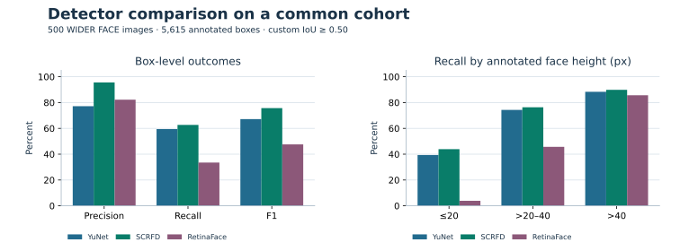
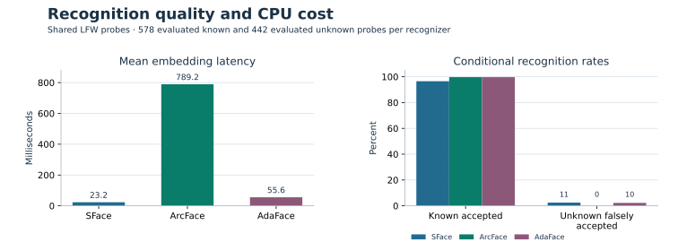
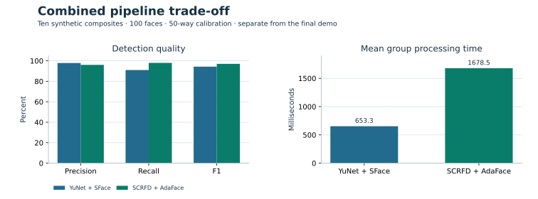
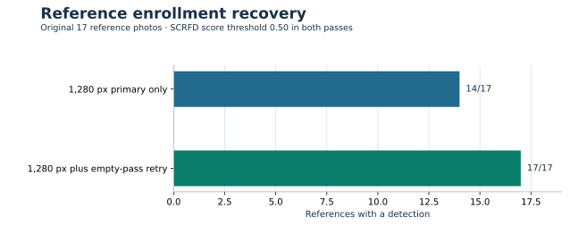
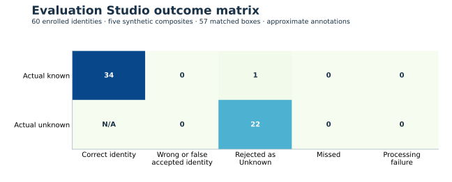
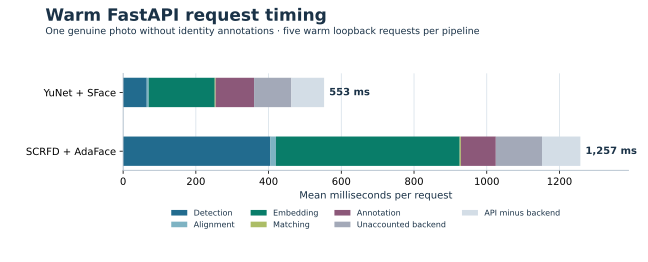

# FaceFind research report

**Applied computer vision for offline open-set identification**

[Summary](#executive-summary) · [Problem](#problem-formulation) · [Cohorts](#experimental-cohort-register) · [Models](#model-architecture-and-training-objectives) · [Detection](#detector-experiments) · [Recognition](#recognition-experiments) · [Calibration](#calibration-and-deployed-rules) · [Failure investigations](#engineering-case-studies) · [Final demo](#evaluation-studio-demonstration) · [Decision and limits](#multi-objective-decision)

## Executive summary

FaceFind needed a detector that handled group photographs on CPU, a recognizer that could decline unmatched identities, and a bundled setup an evaluator could run without optional weights. A single score could not answer all three questions.

- **SCRFD earned its place on a shared detector cohort.** On 500 WIDER FACE images, it improved precision by **18.4 percentage points** and recall by **3.2 points** over YuNet, raising custom F1 from **.6716 to .7570**. Mean detector latency rose from **100 to 526 ms**. Its recall advantage was consistent across the saved face-height buckets.
- **AdaFace balanced known-face identification and CPU cost.** AdaFace and ArcFace each accepted **576/578** correctly identified known probes in the recognition-only test. ArcFace falsely accepted **0/442** evaluated unknown probes versus AdaFace's **10/442**, but averaged **789 ms** per embedding versus AdaFace's **56 ms**. The combined SCRFD + AdaFace pipeline subsequently improved known acceptance and detection recall on separate cohorts.
- **A valid gallery had to be established before judging recognition.** The initial open-set run selected 200 identities but enrolled only 146. The corrected protocol verified enrollment before retaining known probes and used reserves to restore gallery size. Earlier and corrected results remain separate.
- **Application failures required their own evidence.** SCRFD missed three real reference faces despite its benchmark advantage. A gallery-only 640-pixel retry recovered all three. A separate brick-wall detection exposed the limits of overlap-based suppression and dominant-face selection.
- **Evaluation Studio made correctness reviewable.** A 60-identity gallery and five independently annotated synthetic composites produced **56/57 correct outcomes**, including one known rejection. The earlier genuine-photo benchmark established application latency and inference behavior. The synthetic run adds measured correctness for its own cohort.

YuNet + SFace remains the bundled configuration for distribution, lower CPU latency and startup recovery. SCRFD + AdaFace remains the preferred authorized local research configuration. The [evidence index](docs/research/EVIDENCE.md) traces the claims to saved runs.

## Problem formulation

**Detection** estimates a face box and landmarks. **Alignment** maps the landmarks to a common crop. **Embedding** represents that aligned face as a vector in the selected model's feature space. FaceFind compares L2-normalized vectors, so cosine similarity for probe (q) and gallery identity (i) is (s_i = q^	op g_i).

Rank-1 identification asks whether $\arg\max_i s_i$ is the annotated identity before any acceptance rule. In open-set inference, the top score $s_1$ and gap $s_1-s_2$ must clear model-specific bounds before FaceFind confirms an identity. The fallback also has a tentative Possible state. Similarity is a ranking quantity and carries no calibrated probability of correctness. Larger galleries can increase opportunities for impostor matches. Pose, illumination, occlusion, framing and resolution affect different stages.

When several detections compete for one gallery identity, the application preserves the highest-scoring assignment and applies pipeline-specific demotion to the others. The final outcome is then frozen. Evaluation compares that outcome with independent annotations. It counts localization and assignment errors separately, so a missing box or failed embedding cannot become a successful Unknown rejection.

## Retrospective research questions

1. Which detector offers a useful precision, recall and latency trade-off on the same faces?
2. Which recognition model balances known acceptance, unknown rejection, checkpoint size and CPU cost?
3. Which gallery and calibration protocols produce interpretable operating points?
4. How do detector results transfer to local enrollment, where framing differs from benchmark images?
5. When can automatic reference selection reduce effort, and when does intent require a human?
6. How can a demonstration distinguish detection and recognition outputs from verified correctness?

These questions organize completed work retrospectively.

## Experimental cohort register

| Cohort | Sample and selection | Configuration and denominator | Comparison boundary |
|---|---|---|---|
| YuNet baselines | Fixed seed-42 mixed sample, 500 images and 5,615 eligible boxes. Separate census of 1,118 one-eligible-face images and a 20-image failure audit. | Production YuNet at score .50, NMS .30, long edge ≤1,280 px. Custom box precision and recall. | Single-annotation and failure-enriched subsets answer different questions from the mixed cohort. |
| Three-detector WIDER FACE | Same 500 images and 5,615 boxes for all three detectors. | Common resize and stride padding. Score/NMS .50/.30 YuNet, .50/.40 SCRFD, .40/.40 RetinaFace. Box-level matching and per-image CPU latency. | Same inputs within this comparison. Standalone YuNet used unpadded evaluation. |
| Partial YOLO comparison | First 1,500 identical image rows available to both detectors from an intended 3,226-image run. 25,263 boxes. | Custom IoU .50. Saved prediction rows and per-height counts. | Partial shared sample. No comparable latency records. |
| Open-set v1 and v2 | LFW, 200 known identities selected in each. V1 enrolled 146; v2 enrolled 200. Known probes changed from 696 to 756. | YuNet + SFace. V2 includes 557 unknown probe attempts and compares legacy and altered Possible margins. | V1's mismatched gallery makes its known score misleading. V2 has a different cohort. |
| Recognition-only LFW | One 200-way gallery, 756 known and 557 unknown probes. Shared evaluated denominators of 578 known and 442 unknown per model. | Shared YuNet single-face policy, three recognizers, per-model frozen similarity threshold. | Isolates recognizer trade-offs under fixed detections. |
| Combined LFW | Same fixed 200-way test split, 1,313 probes. Distinct calibration identities within this experiment. | Deterministic face selection, separate per-pipeline score and margin, all probes processed. | Different detection and face-selection policies from the recognition-only run. |
| Combined group comparison | Ten synthetic composites, 100 annotated faces, half known. | 50-way calibration, box-matched person metrics, same composites for both pipelines. | Haar-derived boxes and research matching. Separate from the five-composite Studio demo. |
| Adaptive enrollment | Original 17 references and separate 23-input validation set. | SCRFD .50 / NMS .40, 1,280 px primary, 640 px zero-result retry. Reference coverage and retry timing. | Targeted investigation rather than a representative detection or identity benchmark. |
| Smart selection | Original 17 references plus multi-person controls and six deliberately difficult smaller-target cases. | Compare strict review to the dominant-face heuristic. Measure reviews and correct intent in inspected cases. | Lower review count can include wrong automatic choices. |
| FastAPI latency | Same 52 reference inputs and one genuine group photo. Five warm requests per pipeline. | Loopback HTTP, per-stage and request milliseconds, different final enrollment sizes. | No identity annotations and no identity accuracy claim. |
| Evaluation Studio | 60 enrolled identities, five synthetic composites, 35 known and 22 unknown faces. | Deployed SCRFD + AdaFace rule, one-to-one IoU .50, actual gallery membership and all annotated faces. | Approximate boxes, synthetic images, and verified identity overlap with calibration pools. |

## Model architecture and training objectives

The published model families explain which trade-offs were plausible. The local checkpoint and adapter determine the result that was measured.

| Model | Relevant design | Local variant and role |
|---|---|---|
| YuNet | Compact anchor-free face detector designed for edge latency. It predicts face boxes and five landmark locations. | OpenCV Zoo March 2023 ONNX, through OpenCV FaceDetectorYN. [Paper](https://link.springer.com/article/10.1007/s11633-023-1423-y) |
| RetinaFace | Dense single-stage multi-scale detection, with landmark supervision alongside localization in the published design. | MobileNet 0.25 ONNX export with its own input layout and preprocessing. Its local results do not generalize to every RetinaFace backbone. [CVPR paper](https://openaccess.thecvf.com/content_CVPR_2020/html/Deng_RetinaFace_Single-Shot_Multi-Level_Face_Localisation_in_the_Wild_CVPR_2020_paper.html) |
| SCRFD | Redistributes training samples and computational capacity across the detector's scales and stages to balance efficiency and face coverage. | InsightFace SCRFD-10G-KPS, stride-padded input and five landmarks. [Paper](https://arxiv.org/abs/2105.04714) |
| YOLOv8n-Face | Small single-stage YOLO-family face-detection export. The local adapter measures its box output. | Third-party `yolov8n-face.onnx`. The exact training recipe is unverified. [Upstream inference implementation](https://github.com/yakhyo/yolov8-face-onnx-inference) |
| SFace | Sigmoid-constrained hypersphere loss adjusts the attraction and separation gradients for intra-class and inter-class training examples. | Bundled OpenCV Zoo MobileFaceNet-family recognizer, 128 dimensions, OpenCV five-point alignment. [Paper](https://arxiv.org/abs/2205.12010) |
| ArcFace | Additive angular margin in the normalized classification space encourages tighter class separation. | InsightFace ResNet100 recognition checkpoint, 512 dimensions. Evaluated as a research control. [Paper](https://arxiv.org/abs/1801.07698) |
| AdaFace | Quality-adaptive margin uses training feature norm as a proxy for image quality to adjust supervision. | IR-18 ONNX export, 512 dimensions, five-point similarity transform to 112 × 112 followed by BGR normalization and normalized output. [Paper](https://arxiv.org/abs/2204.00964) |

The recognizer-only comparison holds YuNet detections fixed and uses the appropriate alignment and input normalization for each recognizer. [Checkpoint fingerprints and rights](models/face/MODEL_LICENSES.md)

## Detector experiments

### Protocol and initial YuNet measurements

The [WIDER FACE dataset](https://shuoyang1213.me/WIDERFACE/) provides validation images and annotated face boxes. The evaluator reads the image path, box count and annotation rows, converts valid boxes to a common coordinate convention, and matches predictions in descending detector score to the highest-IoU unmatched eligible annotation at IoU ≥ 0.50. Matches are TP, unmatched predictions FP and unmatched annotations FN. Precision is TP/(TP+FP), recall is TP/(TP+FN), and F1 is their harmonic mean. Exclusions such as unreadable images are reported separately. This is a custom box protocol. Official WIDER FACE Easy/Medium/Hard AP uses a different evaluation procedure.

| Production YuNet cohort | Images | Annotated faces | TP | FP | FN | Precision | Recall | F1 |
|---|---:|---:|---:|---:|---:|---:|---:|---:|
| Mixed density, fixed seed 42 | 500 | 5,615 | 3,342 | 983 | 2,273 | .7727 | .5952 | .6724 |
| All images with exactly one eligible annotated face | 1,118 | 1,118 | 1,004 | 383 | 114 | .7239 | .8980 | .8016 |

A single eligible annotation does not establish that only one person or face is visible. The seed-42 failure audit selected 10 images with misses and 10 with additional predictions from that cohort. The diagnostic rerun recorded 8 TP, 22 FP and 12 FN across the selected images. This failure-enriched selection cannot estimate overall failure prevalence. Low IoU can count a localized but displaced prediction as both an FP and an FN. Extra detections can also include real but unannotated faces. The saved artifact has coordinate evidence and examples. It does not establish separate blur, occlusion, or boundary-proximity effects. The controlled face-height results below quantify the size association directly.

### Controlled three-detector comparison

The compared detectors received the same 500 WIDER FACE images and 5,615 annotated faces. Both saved manifests contain the same 500 unique image paths. The comparison uses common aspect-preserving resize and bottom/right stride padding. The saved settings identify that as the preprocessing difference from the original unpadded standalone YuNet evaluator. The four-count TP/FP shifts are reported separately. A controlled rerun isolating padding alone was not recorded. CPU timing includes preprocessing and detection, including any first-use overhead, and excludes file loads and IoU matching.

| Detector | TP | FP | FN | Precision | Recall | F1 | Mean / median / p95 ms |
|---|---:|---:|---:|---:|---:|---:|---:|
| YuNet | 3,338 | 987 | 2,277 | .7718 | .5945 | .6716 | 99.71 / 92.65 / 171.55 |
| SCRFD-10G-KPS | 3,519 | 163 | 2,096 | .9557 | .6267 | .7570 | 526.14 / 483.75 / 891.80 |
| RetinaFace MobileNet 0.25 | 1,881 | 407 | 3,734 | .8221 | .3350 | .4760 | 106.59 / 94.05 / 185.96 |

| Annotated height | Faces | YuNet recall | SCRFD recall | RetinaFace recall |
|---|---:|---:|---:|---:|
| ≤20 px | 2,931 | .3937 | .4391 | .0389 |
| >20–40 px | 1,331 | .7431 | .7633 | .4568 |
| >40 px | 1,353 | .8832 | .8987 | .8566 |

SCRFD improved recall in each size bucket and produced far fewer unmatched predictions than YuNet, at higher CPU cost. Even SCRFD missed most annotations in the smallest bucket. This RetinaFace export recovered few tiny faces, so its results did not justify selecting it for the project. A separate two-way pilot and 500-image run exist. Their measured latencies are kept separate from this table. See [checkpoint sizes and rights](models/face/MODEL_LICENSES.md).

*Figure 1. Both panels use the same 500-image comparison. The smallest bucket contains 2,931 of 5,615 annotated faces.*

### Partial YOLOv8n-Face comparison

The 3,226-image run was interrupted. The experiment runner records score/NMS settings of .50/.45 for YOLO and .50/.40 for SCRFD. The saved report does not establish the reason. The harness preserved 1,701 YOLO and 1,709 SCRFD prediction rows. It retained the first 1,500 ordered rows common to both files, verified identical unique image paths, and evaluated 25,263 boxes under the custom IoU protocol.

| Detector | TP | FP | FN | Precision | Recall | F1 | Recall ≤20 / >20–40 / >40 px |
|---|---:|---:|---:|---:|---:|---:|---:|
| YOLOv8n-Face | 10,623 | 245 | 14,640 | .9775 | .4205 | .5880 | .1366 / .6403 / .8807 |
| SCRFD-10G-KPS | 16,212 | 748 | 9,051 | .9559 | .6417 | .7679 | .4538 / .8268 / .8992 |

The saved prediction files do not contain comparable per-image timings. No speed ranking is supported. This cohort is independent of the earlier 500-image sample.

### Earlier resize investigation

The historical scaling utility shows that the original and resized image paths were compared. No saved output supports exact before/after counts or the alleged fragmentation of detections. Production YuNet downsizes above a 1,280-pixel long edge and remaps boxes and landmarks. SCRFD uses proportional resize plus stride-32 padding and reverses that transform. See [detector source](face_engine/detector.py) and [SCRFD adapter](face_engine/research_models.py).

## Correcting the open-set cohort

The open-set experiment uses one reference per known identity, held-out known probes, and identity-disjoint unknown probes. The early evaluator required a single detected face for use. The first run chose 200 known identities, but enrolled only **146** while still evaluating probes from the original known list. That made some known probes impossible to identify by construction. Version 2 preflighted references, attempted alternatives and used reserves to restore a consistent 200-identity gallery. It replaced 54 selections, excluded 65 candidates, and verified that the enrolled identities and known probe identities agree. The known probe totals changed from 696 to 756. A model cannot be credited or blamed for an absent gallery identity, and the change in composition prevents a direct pre/post accuracy comparison. The lesson is to assert that every known probe identity has a gallery reference before scoring. The artifact establishes the defect and repair. It does not establish who first found it.

| V2 possible-match margin policy | Known correct / evaluated | Unknown rejected / evaluated | Unknown false IDs / evaluated |
|---|---:|---:|---:|
| Legacy Possible margin .087 | 559 / 578 | 424 / 442 | 18 / 442 |
| Lower Possible margin .050 | 567 / 578 | 383 / 442 | 59 / 442 |
| Higher Possible margin .150 | 528 / 578 | 440 / 442 | 2 / 442 |

This experiment counts possible labels in the identification totals. Of 756 known probes and 557 unknown probes, 178 known and 115 unknown probes failed evaluation; those are not correct rejections. The more permissive possible margin accepted more known identities at the cost of substantially more false unknown assignments.

## Recognition experiments

The saved run used one shared gallery of 200 known identities and 1,313 fixed test probes (756 known, 557 unknown), with 100 unknown identities. The independent calibration set selected 200 known and 40 unknown identities. Only 147 known calibration references passed the single-face policy. The saved threshold summaries include 445 genuine scores, 141 unknown maximum scores and 240 calibration failures per model. Each model's cosine threshold was frozen before test scoring. Rank-1 describes the nearest identity before thresholding. Correct acceptance requires the correct identity above threshold.

| Model | Rank-1 conditional / end-to-end | Correct acceptance conditional / end-to-end | Unknown rejection conditional | FPIR conditional / end-to-end | FNIR conditional / end-to-end | EER / ROC-AUC |
|---|---:|---:|---:|---:|---:|---:|
| SFace | .9896 / .7566 | .9654 / .7381 | .9751 | .0249 / .0197 | .0346 / .2619 | .0059 / .9988 |
| ArcFace | .9983 / .7632 | .9965 / .7619 | 1.0000 | .0000 / .0000 | .0035 / .2381 | .0017 / .9990 |
| AdaFace | .9983 / .7632 | .9965 / .7619 | .9774 | .0226 / .0180 | .0035 / .2381 | .0017 / .9989 |

| Model | Frozen threshold | CPU embedding mean / median / p95 ms | Model MB, decimal | Failed test probes |
|---|---:|---:|---:|---:|
| SFace | .423053 | 23.21 / 22.48 / 31.12 | 38.7 | 293 |
| ArcFace | .368590 | 789.18 / 789.07 / 903.43 | 260.7 | 293 |
| AdaFace | .291446 | 55.64 / 54.77 / 65.59 | 96.1 | 293 |

Conditional rates use processed probes. FPIR is the false positive identification rate for unknowns. FNIR is the false negative identification rate for knowns, including wrong identities and non-acceptance. End-to-end known metrics include failures as misses. End-to-end FPIR divides by all unknown probes and counts only false identifications in the numerator. Its complement would include processing failures, so use the conditional unknown rejection rate and the explicit failure count to interpret performance. The recognizer comparison used Python 3.11.9, OpenCV 4.12.0, and ONNX Runtime 1.32.0 with the CPU execution provider. ArcFace achieved the lowest observed FPIR on this sample but carried the highest CPU latency and file size. AdaFace matched ArcFace's known acceptance results with markedly lower CPU embedding latency.

The legacy result field named `end_to_end_rejection_rate` was calculated as (1-\mathrm{FPIR}_{e2e}). Its numerator includes unprocessed unknown probes. The observed successful rejections and their true denominators are shown below as derived counts. The on-disk benchmark is preserved.

| Model | True unknown rejections / evaluated | True unknown rejections / attempted | False identifications / evaluated |
|---|---:|---:|---:|
| SFace | 431 / 442 | 431 / 557 | 11 / 442 |
| ArcFace | 442 / 442 | 442 / 557 | 0 / 442 |
| AdaFace | 432 / 442 | 432 / 557 | 10 / 442 |

The recognition benchmark's EER and ROC-AUC describe its verification component. The repository contains a separate LFW pairs evaluator, but no completed official pairs result was located.

*Figure 2. Bars on the right use the evaluated probes only. The numbers above the false-acceptance bars are counts out of 442.*

## Calibration and deployed rules

The completed November 24 run changed from requiring a single detection to deterministic face selection on LFW: largest box, then nearest center, then top-left. It records ambiguous probes independently and does not use identity labels or similarity to select a face. Calibration identities are disjoint from test identities. It preflighted 200 usable known calibration identities and froze separate threshold/margin pairs for the 200-way LFW and 50-way group tasks. This procedure and the recognition-only procedure have different failure denominators despite sharing the test protocol. The earlier November 23 combined attempt was blocked before execution and contributes no result.

| Role | Pipeline or recognizer | Score threshold | Top-two margin | Source |
|---|---|---:|---:|---|
| Recognition-only research | SFace / ArcFace / AdaFace | .423053 / .368590 / .291446 | None | Per-model thresholds frozen before shared LFW test |
| Combined LFW research | YuNet + SFace | .427028 | .026805 | 200-way calibration |
| Combined LFW research | SCRFD + AdaFace | .286670 | .062926 | 200-way calibration |
| Combined group research | YuNet + SFace | .385532 | .066137 | 50-way calibration |
| Combined group research | SCRFD + AdaFace | .263616 | .079397 | 50-way calibration |
| Deployed preferred | SCRFD + AdaFace | .26362 | .07940 | Rounded 50-way research values |
| Deployed bundled, confirmed | YuNet + SFace | .50 | .12 | Legacy FaceMatcher defaults |
| Deployed bundled, tentative | YuNet + SFace | .35 | .087 | Legacy FaceMatcher Possible branch |

The legacy SFace rule stays in production. The exact historical rationale for retaining those values was not recorded. The calibrated SFace results therefore describe the research operating points only. The two deployed detector score floors remain .50. YuNet NMS is .30, SCRFD NMS is .40, and SCRFD's reference retry uses the same settings as its primary pass. [Deployed AdaFace settings](face_engine/research_models.py) · [Legacy matcher](face_engine/match.py)

### Calibration and denominator summary

| Protocol | Calibration identities and gallery | Evaluated calibration probes | Test identities and gallery | Test probes and failures |
|---|---|---|---|---|
| Recognition-only LFW | 200 known and 40 unknown sampled. 147 known calibration references passed the single-face policy. | 445 genuine scores, 141 unknown maximum scores and 240 failed calibration probes per model. | 200 known gallery identities and 100 unknown identities. | 756 known and 557 unknown. Of these, 578 known and 442 unknown were evaluated. Failures were 178 known and 115 unknown. |
| Combined LFW | 200 usable known calibration identities and 40 unknown identities. 200-way gallery. | 700 known and 184 unknown per pipeline, zero recorded calibration failures. | 200 known gallery identities and 100 unknown identities. | 756 known and 557 unknown evaluated per pipeline, zero recorded evaluation failures. |
| Combined synthetic groups | 50-way gallery using the separate combined calibration pool. | 201 known and 184 unknown per pipeline, zero recorded calibration failures. | 50 enrolled identities. The composites contain 50 known and 50 unknown face instances. | YuNet matched 46 known and 45 unknown boxes, and SCRFD matched 50 known and 48 unknown. Neither pipeline recorded an embedding failure on the matched boxes. |

The saved recognition-only and combined evaluations report empty calibration/test identity intersections. This separation does not establish whether the model pretraining datasets contained overlapping identities. Frozen thresholds and margins are listed with their respective protocols above. See the [source inventory](docs/research/EVIDENCE.md).

## Combined pipeline comparison

### Fixed LFW cohort

| System | Rank-1 | Known correct+accepted | Unknown rejected | FPIR | FNIR | Ambiguous probes |
|---|---:|---:|---:|---:|---:|---:|
| YuNet + SFace | .9815 | .9511 | .9785 | .0215 | .0489 | 293 |
| SCRFD + AdaFace | .9868 | .9828 | .9820 | .0180 | .0172 | 266 |

Both pipelines used 756 known and 557 unknown probes with zero gallery failures. Saved conditional and end-to-end rates are equal on this run. The ambiguity counts are detections with multiple candidate faces, not processing failures.

### Controlled group composites

Ten composites held 100 faces, evenly split between known and unknown people. Crops came from held-out probe images; enrollment crops were excluded. Transformed Haar boxes supplied composite annotations. Face size, blur, lighting and output resolution varied. The composites provide controlled stress cases and do not measure accuracy on genuine photos.

| System | Detection P / R / F1 | Known correct conditional / end-to-end | Unknown rejection conditional / end-to-end | FPIR conditional / end-to-end | FNIR conditional / end-to-end | Missed | Image mean / median / p95 ms |
|---|---:|---:|---:|---:|---:|---:|---:|
| YuNet + SFace | .9785 / .9100 / .9430 | .7826 / .7200 | .9333 / .8400 | .0667 / .0600 | .2174 / .2800 | 9 | 653.31 / 647.72 / 850.22 |
| SCRFD + AdaFace | .9608 / .9800 / .9703 | .9000 / .9000 | .9583 / .9200 | .0417 / .0400 | .1000 / .1000 | 2 | 1,678.53 / 1,640.30 / 2,589.33 |

Identity metrics use detections matched to ground-truth boxes. Unmatched detections count as detection false positives. Any accepted identity on an unmatched box is outside the person-level FPIR numerator. The group conditional denominators are matched known or unknown boxes, unlike the recognition-only denominators based on evaluated probes. The group end-to-end denominators include every annotated person in the corresponding known or unknown class. The comparison records duplicate assignments before the production duplicate-conflict pass. A missed detection, an embedding failure, and a processed match rejected by the decision rule are distinct outcomes.

Combined checkpoint size was about **38.93 MB** for YuNet + SFace and **113.03 MB** for SCRFD + AdaFace, calculated from local file sizes. SCRFD + AdaFace traded lower synthetic detection precision and greater latency for higher recall and better known identification in this fixed experiment. Real deployment clearance was a separate question from choosing a research/demo default.

*Figure 3. This figure uses the original ten-composite comparison. The later five-composite Evaluation Studio run has a separate protocol and gallery.*

## Engineering case studies

### A. SCRFD missed real references

The real 17-photo reference folder exposed a failure mode outside the detector benchmark. At the normal 1,280-pixel cap, SCRFD produced no candidates above 0.50 for three close-up faces that YuNet detected and visual inspection confirmed. The three SCRFD peak scores were .1202, .0750, and .2891. The candidate lists were empty before NMS or clipping. Rotation and the legacy decoder did not recover the faces. At 640 pixels the three peaks rose to .8938, .7598 and .8102, each yielding one final detection. Holding tensor dimensions fixed while reducing the content scale still recovered all three. The experiment establishes scale sensitivity for those photos without identifying a universal face-size boundary.

The application retains the 1,280-pixel primary pass. Gallery enrollment retries SCRFD at 640 pixels only when the primary pass has no valid boxes. Both passes retain the existing score and NMS settings. Coverage rose from **14/17 to 17/17** in the original folder. Retry detections are mapped to the working image for AdaFace alignment. The table used manual review for every multi-face reference. Analyze uses the original one-pass behavior.

| Validation set | Direct enrollment | Manual selection | Rejected | Retry attempts / detections recovered | Retry total / median |
|---|---:|---:|---:|---:|---:|
| Original 17 references | 14 | 3 | 0 | 3 / 3 | 714.0 / 228.8 ms |
| Separate 23-image validation set | 9 | 9 | 5 | 11 / 6 | 2,419.2 / 203.8 ms |

*Figure 4. Coverage rose by three original references at the same detector score threshold.*

On the original set, all 14 nonempty primary results matched the saved boxes, landmarks and scores exactly; the three recovered references matched the previously visually verified 640-pixel detections. The separate set included six independently selected LFW portraits, six modified portraits covering large framing, blur and low light, three two-face composites, two multi-person composites, one genuine group photo, and five procedural negatives. The retry recovered three degraded close-ups and detected both faces in each of the three two-face composites, which all entered manual review. All five negatives were rejected. Visual inspection checked recovered boxes and landmark placement. All 23 automatically enrolled vectors across both sets were finite, 512-dimensional, and unit-normalized. Retry timings measure the additional detector pass in one local CPU run and exclude decoding and embedding.

The production matching threshold and margin remain unchanged. The checks establish that recovered landmarks can produce valid AdaFace embeddings and that the tested cases preserve enrollment semantics. They do not establish calibration transfer or a false-positive rate on a representative cohort. Broader validation would require annotated real references, hard negatives and disjoint known/unknown probes using retry-enrolled galleries. Private experiment outputs, timings and annotated contact sheets are retained under the reference detection diagnostic run.

### B. Brick-wall false positive

A separate diagnostic confirmed that a second SCRFD box at .5330 enclosed a brick-wall recess. The real face scored .8286 and the two boxes had zero IoU. In working-image XYWH pixels, the true-face candidate was approximately (730.3, 660.9, 323.7, 356.2) and the recess was (1,616.2, 908.5, 63.9, 81.4). Four proposals passed the confidence filter and two remained after NMS. NMS correctly collapsed overlapping proposals for the real face and could not suppress the separate false positive by overlap. YuNet returned one face at .9138 on the same decoded image. The experiment supported exposing both crops for review while preserving detector thresholds.

### C. Smart Auto-Selection and intent

Local validation compared **Always Review Multiple Faces** and **Smart Auto-Selection** through the gallery upload handler using SCRFD-10G-KPS + AdaFace on CPU. The original 17 files included the confirmed brick-wall false positive. The additional set contained one genuine local group photo, two multi-person composites, three similarly sized two-person composites, three unequal-size two-person composites and six genuine two-person photographs from the locally available WIDER FACE validation split. For the six WIDER FACE stress cases, the smaller annotated face was designated as the intended target before inference. Both annotated faces had separate matching detections in every case.

| Validation set | Required reviews, always → smart | Multi-face auto-selections | Incorrect auto-selections |
|---|---:|---:|---:|
| Original 17, including the brick-wall case | 3 → 1 (67% reduction) | 2 | 0 of 2 |
| Genuine local group, 2 multi-person composites and 3 unequal-size composites | 6 → 6 | 0 | 0 |
| Similar-size pairs, area ratios 1.03–1.21 | 3 → 3 | 0 | 0 |
| Genuine two-person photos with the smaller face designated as target | 6 → 3 (50% reduction) | 3 | 3 of 3 |

In the brick-wall photo the intended face had a 22.18× area ratio and a 0.8286 score. The wall candidate scored 0.5330 and remained available in the optional review. The other original auto-selection picked the foreground subject at a 16.03× area ratio and a 0.9005 score. A real background face remained visible in that review. No photos were rejected under either setting. Both settings recovered the same three original references through the existing SCRFD retry. Group analysis returned 14 detections under each setting on the same local group photo.

The test also replaced an incorrect automatic choice with the smaller intended face and verified the embedding and gallery revision changed. A reduction in required reviews counts wrong choices as automatic too. The original 17 measure the local folder only, and the smaller-target cases were deliberately selected to stress the heuristic. Face size and detection score cannot establish which person the uploader intends to enroll.

### D. Evaluation Studio

The owner asked how to tell whether recognized and unrecognized counts were correct. The implementation leaves inference unchanged and evaluates a frozen result against independent boxes or manual correspondences. Box matching maximizes valid one-to-one matches at IoU ≥ 0.50, then total IoU. Matched predictions can be a correct known ID, wrong known ID, known rejection, correct Unknown, false acceptance or processing failure. Unmatched detection and missed annotated face are separate outcomes. Conditional scores use valid matched recognition attempts. End-to-end scores retain misses and failures in the denominator. [Evaluation architecture and formulas](ARCHITECTURE.md#evaluation-studio)

## Evaluation Studio demonstration

This controlled local run used the 60-identity LFW manual-demo gallery and five held-out synthetic composites. It used the current SCRFD + AdaFace configuration with the existing similarity threshold and margin. Strict reference review yielded 57 automatic enrollments and three confirmations. The selected crops were checked visually before interpreting the results. The CSV and JSON agreed on 57 source identities, membership flags and box coordinates. The five answer-key JPEGs were checked at the annotated locations, and the manifest SHA-256 values matched the analyzed files.

| Composite | Known / unknown | TP / FP / FN | Correct known | Known rejected | Correct unknown | False acceptances | Overall correct |
|---|---:|---:|---:|---:|---:|---:|---:|
| Easy | 7 / 3 | 10 / 0 / 0 | 6 / 7 | 1 | 3 / 3 | 0 | 9 / 10 |
| Medium | 8 / 4 | 12 / 0 / 0 | 8 / 8 | 0 | 4 / 4 | 0 | 12 / 12 |
| Hard | 10 / 5 | 15 / 0 / 0 | 10 / 10 | 0 | 5 / 5 | 0 | 15 / 15 |
| All Unknown | 0 / 10 | 10 / 0 / 0 | N/A | 0 | 10 / 10 | 0 | 10 / 10 |
| All Known | 10 / 0 | 10 / 0 / 0 | 10 / 10 | 0 | N/A | 0 | 10 / 10 |
| **Combined counts** | **35 / 22** | **57 / 0 / 0** | **34 / 35** | **1** | **22 / 22** | **0** | **56 / 57** |

There were no wrong known assignments or processing failures in this run. Conditional and end-to-end recognition denominators coincide because every annotated face was matched and processed. These are five purpose-built composites with approximate projected source boxes and one local gallery. No thresholds were tuned on this run. The 60-way deployed gallery used the score and margin derived from the earlier 50-way calibration. [Protocol and metric definitions](ARCHITECTURE.md#evaluation-studio).

*Figure 5. One known face was rejected. All 22 annotated unknown faces had a valid Unknown outcome. Unmatched detections were zero and are counted outside the person-level matrix.*

### Identity overlap audit

The documentation audit matched normalized LFW identity strings across the retained splits and the final demo gallery and probe annotations. The comparison used case-folding and normalized underscores and spaces. It exposes identity overlap without releasing names.

| Earlier calibration set | Demo 60-identity gallery | Demo 35 known probe identities | Demo 22 unknown probe identities |
|---|---:|---:|---:|
| 50 enrolled identities in the deployed rule's calibration gallery | 4 | 2 | 3 |
| Full combined pool of 200 enrolled and 40 unknown identities | 10 | 7 | 4 |
| Recognition-only pool of 200 selected known and 40 selected unknown identities | 10 | 7 | 4 |

The 50-way row compares the enrolled portion only. The associated 40 unknown calibration identities overlapped two demo gallery identities and two known probe identities, and no demo unknown probe identities. Counts are per column and must not be summed because the demo known probes are enrolled. The audit identifies shared names. It does not establish exact image reuse across calibration and demo or overlap with model pretraining. The final demo is an independent-annotation workflow check with partial identity overlap, so it cannot establish held-out identity generalization.

### Descriptive uncertainty

Derived 95% Wilson intervals are **90.7–99.7%** for 56/57 overall, **85.5–99.5%** for 34/35 known, and **85.1–100%** for 22/22 unknown. The binomial calculation treats outcomes as independent draws at a common success probability. These faces share composites and a gallery and were deliberately selected, so the intervals illustrate small-sample uncertainty rather than population coverage. Comparisons on shared probes would require paired analysis. No significance test was run.

## Application timing

The local harness started Uvicorn and issued HTTP requests over loopback. Both pipelines received the same 52 prepared references and one genuine group photo, with one first analysis and five warm requests per model. For timing only, the harness resolved ambiguous references by selecting the largest detected face. The current production UI supports strict review and optional Smart selection with manual correction. The CPU model and memory were not recorded in the report, and resource sampling was unavailable because `psutil` was absent.

| Pipeline | Init ms | Enrolled / rejected / manual¹ | Gallery request ms | Detected / assigned | First API ms | Warm API mean / median / p95 / max ms | Warm backend mean / median / p95 ms |
|---|---:|---:|---:|---:|---:|---:|---:|
| SCRFD + AdaFace | 1,971.0 | 50 / 2 / 11 | 11,105.0 | 14 / 8 | 1,283.0 | 1,257.4 / 1,222.3 / 1,340.3 / 1,343.4 | 1,151.9 / 1,159.6 / 1,226.0 |
| YuNet + SFace | 143.1 | 52 / 0 / 10 | 2,225.6 | 13 / 6 | 645.4 | 552.7 / 551.6 / 581.2 / 582.1 | 462.6 / 451.9 / 501.9 |

¹ Manual selections are included in final enrollment. Gallery client time includes the upload and the manual-selection requests. Both caches reported zero gallery embedding time during repeated analysis.

| Warm stage mean, ms | Detect | Align | Embed | Match | Annotate and render |
|---|---:|---:|---:|---:|---:|
| SCRFD + AdaFace | 405.1 | 15.1 | 505.4 | 3.3 | 96.1 |
| YuNet + SFace | 65.0 | 5.2 | 181.7 | 2.4 | 105.8 |

The group photo was unannotated. The assigned counts describe application output. No identity correctness can be derived, and enrollment ended with different galleries. The reported latency includes the conditions of this one-photo benchmark.

The five instrumented stage means total **1,024.9 ms** for SCRFD + AdaFace and **360.1 ms** for YuNet + SFace. Subtracting them from the mean backend totals leaves **127.0 ms** and **102.5 ms**, respectively, unaccounted by those named stages. Mean request minus backend time adds **105.5 ms** and **90.1 ms**. The saved instrumentation does not break either remainder down further.

*Figure 6. Mean latency components use the same five recorded requests per pipeline. The stack includes the unresolved backend remainder and the API-minus-backend difference.*

## Multi-objective decision

| Criterion | Preferred SCRFD + AdaFace | Bundled YuNet + SFace |
|---|---|---|
| Detector accuracy on the common 500-image sample | P/R/F1 .9557/.6267/.7570 | .7718/.5945/.6716 |
| System identification in combined LFW test | Known .9828, unknown rejection .9820 | Known .9511, unknown rejection .9785, with research calibration |
| Detection on the ten-composite comparison | Recall .9800, precision .9608 | Recall .9100, precision .9785 |
| Local warm loopback mean | 1,257 ms | 553 ms |
| Combined checkpoint size | 113.03 decimal MB | 38.93 decimal MB |
| Runtime and calibration | Optional CPU runtime and separately supplied weights; rounded 50-way calibration | OpenCV and bundled checkpoints; legacy acceptance and tentative rules |
| Rights | SCRFD pretrained terms restrict use to non-commercial research. AdaFace checkpoint grant is unresolved. | Bundled MIT and Apache-2.0 notices. Training-data and product-deployment rights remain separate. |
| Role | Preferred local research and demonstration path | Independently runnable evaluator setup and startup recovery |

The preferred system buys better group recall and known identification at greater compute and deployment cost. ArcFace remains useful evidence that another operating trade-off existed. Its stronger observed unknown rejection in the recognition-only cohort did not offset its local embedding cost for this workstation application. The fallback remains valuable independently of the preferred model comparison.

## Threats to validity

- **Cohort and annotation design.** Custom WIDER FACE box metrics are separate from official AP. The partial YOLO run covers the shared 1,500-image prefix only. Its interruption reason is unavailable. LFW faces, failure-enriched enrollment examples and genuine group photographs represent different conditions.
- **Synthetic images and overlap.** Both group-composite cohorts have projected annotations. The final cohort shares identities with calibration, and overlap with training datasets was not established. The genuine photo benchmark has no identity ground truth.
- **Scale and conditional selection.** Small stress sets expose specific failure mechanisms. Conditional recognition can remove detection or processing failures from its denominator. Report it alongside end-to-end rates and raw counts.
- **Hardware and rights.** CPU timings describe recorded local runs only. The app performance record lacks a confirmed CPU SKU and measured memory profile. Checkpoint availability and rights constrain deployment. [Checkpoint and dataset rights](models/face/MODEL_LICENSES.md)

## Future Research and Validation

These proposals define validation work beyond the frozen release. Each experiment should document cohort construction, calibration splits, operating points and failure counts before drawing deployment conclusions.

| Priority | Motivation and proposed design | Reported measures and engineering value |
|---|---|---|
| High · Genuine group photographs | Build a representative, separately annotated benchmark with redistribution permission. Sample face sizes, blur, occlusion, illumination and pose, and predefine the gallery and operating point. | Stratified detection precision and recall, conditional recognition and end-to-end known acceptance and unknown rejection. Trace misses by stage to prioritize changes. |
| High · Open-set calibration | Use larger disjoint identity pools, independent calibration/test splits and a deliberately labeled look-alike set. Repeat at multiple gallery sizes with paired probes and frozen policies per size. Audit false accepts and rejected known identities. | FPIR and FNIR by gallery size, error category and subgroup, with uncertainty and numerator/denominator. Estimate how calibration transfers across operating conditions. |
| High · Adaptive enrollment | Compare the primary pass and zero-result retry on unseen reference photos with annotated intended faces and distractors. Stratify by face scale and quality, and include existing successful enrollments as a control. | Intended-face recovery, added false positives, review burden and retry latency. Determine when adaptive enrollment improves the actual selection workflow. |
| Performance · CPU and memory | Profile repeated requests and stage timings across machines. Compare ONNX Runtime options, quantization and batched embeddings against the frozen pipeline. | Warm and cold latency, p95, throughput, peak working set and paired changes to FPIR/FNIR. Choose an operating point with measured accuracy cost. |
| Performance · Larger galleries | Scale the exact search beyond the assignment gallery with controlled probe counts. Evaluate approximate retrieval only if profiling identifies matching as a bottleneck. | Search latency, memory, top-k recall and end-to-end decision changes. Establish when indexing cost is justified. |
| Usability · Compatibility and review | Build fixtures for additional image formats and Unicode scripts, with keyboard-only tasks across target desktop platforms. Test ambiguity controls and pre-enrollment quality feedback on consented examples. | Decode and rendering pass rates, accessibility task completion, review time and intended-face selection errors. Improve diagnosis and recovery for operators. |
| Longer term · Identity representation and persistence | Compare single references with multiple views and quality-aware aggregation. Prototype local persistent storage only after assessing data minimization, consent, deletion and model/data rights. | Calibration transfer, error rates by reference quality, storage and deletion checks. Determine whether additional reference data or persistence provides sufficient practical value. |

## Data and primary references

The saved evidence supports WIDER FACE for detection, LFW for recognition and composite sources, and local references and a genuine photograph for application checks. No experimental use of CelebA, Open Images, CFP-FP, AgeDB or SoloFace2 was verified. The claimed SoloFace2 circularity concern and the exact original single-photo resize counts remain evidence gaps.

- Dataset sources: [WIDER FACE paper](https://www.cv-foundation.org/openaccess/content_cvpr_2016/html/Yang_WIDER_FACE_A_CVPR_2016_paper.html) and [Labeled Faces in the Wild report](https://people.cs.umass.edu/~elm/papers/lfw.pdf).
- Model papers and export variants are linked in the [model register above](#model-architecture-and-training-objectives).
- [Evidence index](docs/research/EVIDENCE.md), [figure inputs](docs/research/benchmark-aggregates.json), and [figure generator](docs/research/render_figures.py).
